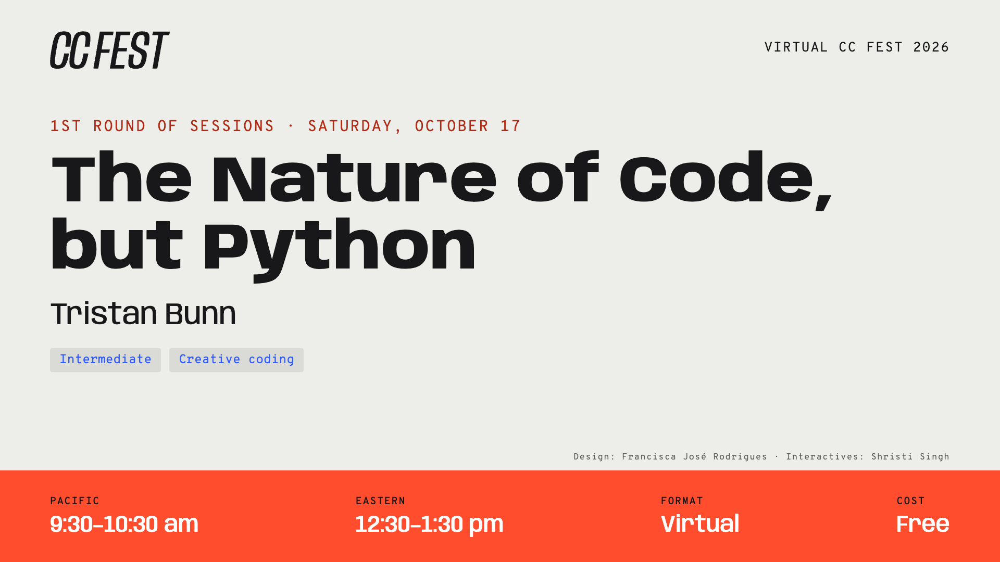

# The Nature of Code, but Python

*Resources for my Virtual CC Fest 2026 session (The Nature of Code, but Python)*



---


## About

A session exploring how The Nature of Code (p5.js) translates into Python using [py5](https://py5coding.org), looking at which techniques translate directly, which require rethinking (particularly where substituting libraries is unavoidable), and where Python offers opportunities to simplify the original JavaScript implementation.

The complete py5 implementations of Daniel Shiffman's "The Nature of Code" (2024 edition), upon which the session is based, is available here:

<https://github.com/tabreturn/py5-nature-of-code>

It's also listed under the book's [Additional Resources chapter](https://natureofcode.com/resources), among ports to other languages.


## Slide-Deck

[deck.pdf](https://raw.githubusercontent.com/tabreturn/cc-fest-noc-py5/main/deck.pdf)


## Useful Resources

- [py5 website](https://py5coding.org/)
- [py5 reference](https://py5coding.org/reference)
- [py5 cheatsheet](https://raw.githubusercontent.com/tabreturn/processing.py-cheat-sheet/master/py5/py5_cc.pdf)
- [The Nature of Code](https://natureofcode.com/) by Daniel Shiffman (free online)
- [Villares' sketch-a-day](https://abav.lugaralgum.com/sketch-a-day)


## Rendering the Deck

Install Marp (one-time):

```bash
cd marp_style && npm install
```

Live preview (watch + presenter view):

```bash
./render
```

Export PDF (to `deck.pdf` in the repository root):

```bash
./render --pdf
```

