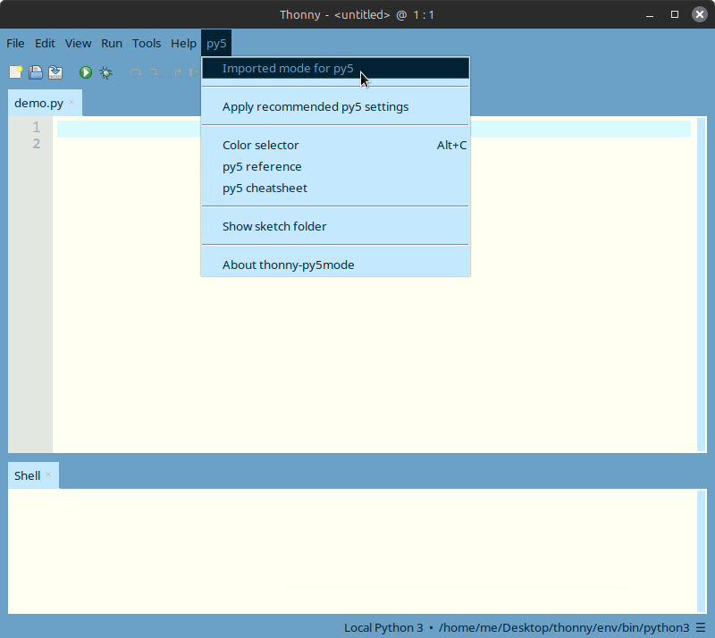
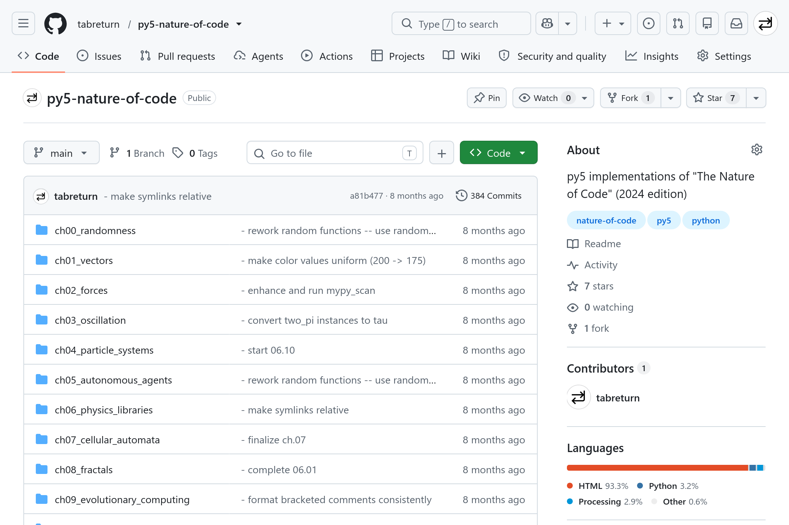
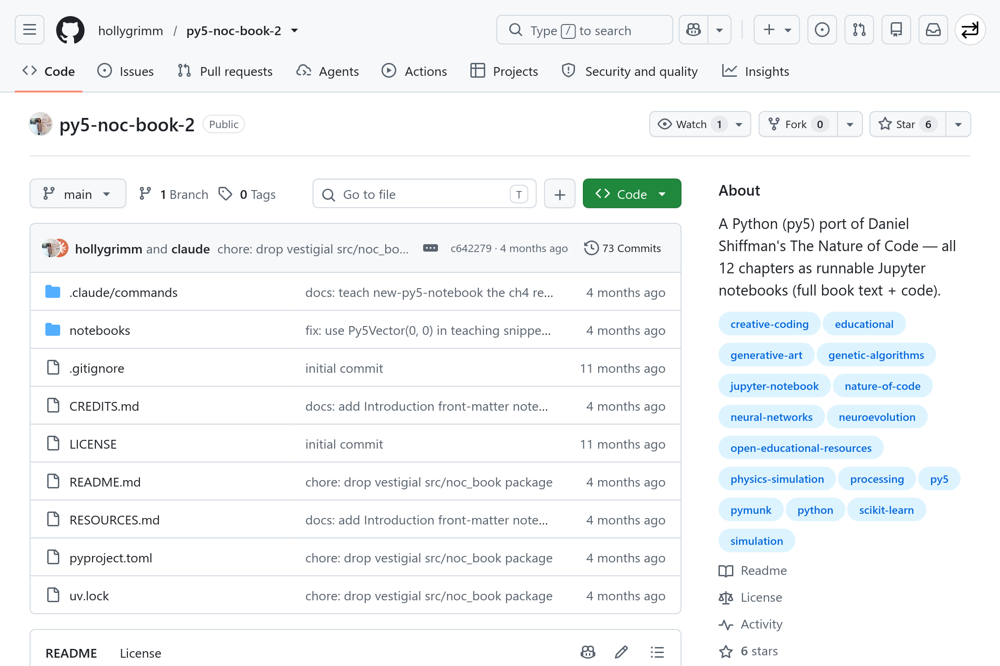
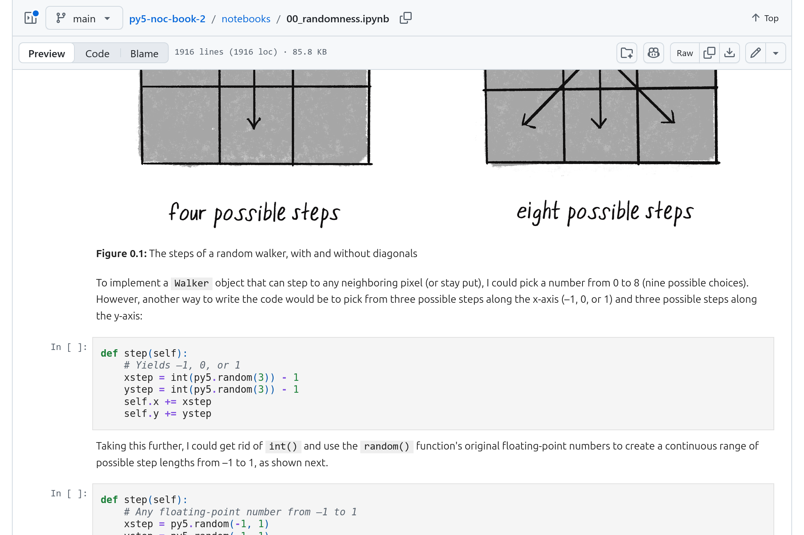

# ***The Nature of Code, but Python***
<!-- 
_backgroundImage: "url(title_bg.png)"
_backgroundSize: "cover"
_color: var(--color-background)
-->
<!--
- a session exploring how the nature of code (p5.js) translates into python using py5
- three porting threads: translate directly, rethink logic, simplify code
-->

---

# Introduction
<!-- 
paginate: true
backgroundColor: darkslategrey
color: var(--color-background)
-->

---

<!--
_backgroundColor: white
_paginate: false
-->

> https://tisch.nyu.edu/itp/news/fall-2024/daniel-shiffman--itp-faculty-member--launches-new-book---the-nat
<!--
- note this is the 2nd edition (no starch press)
- show of hands: who has worked through any nature of code chapters?
- for anybody unfamiliar: the book builds up from simple random walks to vectors to physics to neural networks & neuroevolution
- as audience likely knows, this is (p5.)js-based
-->

---

<!--
_backgroundColor: #EEE
_paginate: false
-->

> https://py5coding.org
<!--
- in order to port from javascript to python ... [NEXT SLIDE]
-->

---

<!--
_backgroundColor: #EEE
_paginate: false
-->

> https://py5coding.org
<!--
- i opted to use py5 as a processing framework
-->

---

<!--
_backgroundColor: #EEE
_paginate: false
-->

> https://py5coding.org
<!--
- for those who are unfamiliar with py5, find out more at py5coding.org
-->

---

## Introduction  » py5 Features
* <highlight>Modern Python:</highlight> Full Python 3.x+ support
* <highlight>Processing Engine:</highlight> Fast Java graphics backend via JPype
* <highlight>Java Bridge:</highlight> Can load and use many existing Java Processing libraries
* <highlight>Data Science Ready:</highlight> Native integration with NumPy, Pandas
* <highlight>Any Editor:</highlight> Works in Jupyter Notebooks, VS Code, ...
* <highlight>Fast Pixels:</highlight> Vectorized pixel manipulation using NumPy arrays
* <highlight>Flexible Modes:</highlight> Choose Imported (beginner), Module, or Class

---

## Introduction » Run py5
* <highlight>Standard Python script:</highlight> VS Code, PyCharm, terminal, ...
* <highlight>Jupyter Notebook:</highlight> Via standard ipykernel, or py5 kernel
* <highlight>Thonny-py5mode:</highlight> Thonny IDE + py5 plugin 🠄
<!--
- discuss pros/cons of each:
- standard -- any editor; requires manual environment/pip setup
- jupyter -- notebook format mixing different cells (good for teaching?); perhaps not your style
- thonny -- familiar to legacy processing users; feels 'dedicated'; perhaps not your style
-->

---

<!--
_backgroundColor: #EEE
_paginate: false
-->

> https://thonny.org

---

## Introduction » Thonny Features
- <highlight>Beginner-Focused:</highlight> Minimal, uncluttered interface designed for learning
- <highlight>Bundled Python:</highlight> Includes a built-in Python 3 runtime
- <highlight>Cross-Platform:</highlight> Runs seamlessly on Linux, macOS, Windows
- <highlight>Fully Portable:</highlight> Runs directly from a USB drive without admin rights
- <highlight>Several Neat Panels:</highlight> Interactive shell, plotter, outline, and more

---

## Introduction » Thonny-py5mode Installation
*A plugin that turns the Thonny IDE into a Python 3 replacement for the original Processing IDE.*
<br /><hr />
<highlight>Process</highlight><br />

1. Install Thonny
2. Add plugin
<!--
- recall that thonny-py5mode uses py5
- note that processing.py is no longer supported in processing (since version 4), and is python 2
-->

---

<!--
_backgroundColor: #000
_paginate: false
-->


---

<!--
_backgroundColor: #000
_paginate: false
-->


---

<!--
_backgroundColor: #000
_paginate: false
-->


---

<!--
_backgroundColor: #000
_paginate: false
-->


---

<!--
_backgroundColor: #000
_paginate: false
-->


---

<!--
_backgroundColor: #000
_paginate: false
-->


---

<!--
_backgroundColor: #000
_paginate: false
_class: lead
-->
*... restarting ...*

---

<!--
_backgroundColor: #000
_paginate: false
-->

<!--
- you don't *have to use* imported mode, but this means:
- no import line(s) required
- no py5. prefix for every method
- so, matches* traditional processing and p5.js syntax
- easier porting (to py5)
- more beginner-friendly
-->

---

<!--
_backgroundColor: #000
_paginate: false
-->

<!--
- if java is not detected, it'll download and install a local version
--->

---

<!--
_backgroundColor: #000
_paginate: false
-->


---

<!--
_backgroundColor: #000
_paginate: false
-->


---

<!--
_backgroundColor: #000
_paginate: false
-->

<!--
- just like processing, it has a static mode
- (of course, there are setup and draw functions for animated sketches)
-->

---

<!--
_backgroundColor: #000
_paginate: false
-->

<!--
- as i mentioned earlier, there is also a module mode
-->

---

<!--
_backgroundColor: #000
_paginate: false
-->

<!--
- note: import line, py5 prefixes, run_sketch method
-->

---

# py5
<!-- 
paginate: true
backgroundColor: maroon
color: var(--color-background)
-->

---

## py5 » Simple Sketch

```python
def setup():
    size(640, 240)

def draw():
    background(255)
    circle(mouse_x, mouse_y, 48)
```

---

## py5 » Porting Approach

- **Translate Directly** -- vectors, forces, particles: near line-for-line
- **Rethink Logic** -- p5.js-exclusive libraries need substitutes
- **Simplify Code** -- Python idioms shorten the original JavaScript

---

## py5 » Substitutions

<table style="width:100%;border:none">
  <tr style="background-color:rgba(0,0,0,0.3)">
    <td style="border-color:rgba(0,0,0,0.3)">p5.js (original)</td>
    <td style="border-color:rgba(0,0,0,0.3)">Python (py5)</td>
  </tr>
  <tr style="background:none">
    <td style="border-color:rgba(0,0,0,0.3);background:transparent">Matter.js</td>
    <td style="border-color:rgba(0,0,0,0.3);background:transparent">Pymunk (Chipmunk2D wrapper)</td>
  </tr>
  <tr>
    <td style="border-color:rgba(0,0,0,0.3);background:transparent">toxiclibs.js</td>
    <td style="border-color:rgba(0,0,0,0.3);background:transparent">Toxiclibs *Java* library via the JVM</td>
  </tr>
  <tr style="background:none">
    <td style="border-color:rgba(0,0,0,0.3);background:transparent">ml5.js</td>
    <td style="border-color:rgba(0,0,0,0.3);background:transparent">scikit-learn / bespoke NumPy</td>
  </tr>
</table>

---


# Translate Directly
<!-- 
backgroundColor: indigo
color: var(--color-background)
-->

---

## Translate Directly » py5 Naming

```javascript
// p5.js
function setup() {
  createCanvas(640, 240);
}
function draw() {
  circle(mouseX, mouseY, 48);
}
```
```python
# py5
def setup():
    size(640, 240)
def draw():
    circle(mouse_x, mouse_y, 48)
```

---

## Translate Directly » Renames to Know

<table style="width:100%;border:none">
  <tr style="background-color:rgba(0,0,0,0.3)">
    <td style="border-color:rgba(0,0,0,0.3)">p5.js</td>
    <td style="border-color:rgba(0,0,0,0.3)">py5</td>
    <td style="border-color:rgba(0,0,0,0.3)">Why</td>
  </tr>
  <tr style="background:none">
    <td style="border-color:rgba(0,0,0,0.3);background:transparent"><code>createCanvas()</code></td>
    <td style="border-color:rgba(0,0,0,0.3);background:transparent"><code>size()</code></td>
    <td style="border-color:rgba(0,0,0,0.3);background:transparent">Processing Java</td>
  </tr>
  <tr>
    <td style="border-color:rgba(0,0,0,0.3);background:transparent"><code>map()</code></td>
    <td style="border-color:rgba(0,0,0,0.3);background:transparent"><code>remap()</code></td>
    <td style="border-color:rgba(0,0,0,0.3);background:transparent"><code>map()</code> Python built-in</td>
  </tr>
  <tr style="background:none">
    <td style="border-color:rgba(0,0,0,0.3);background:transparent"><code>mouseX</code>, <code>strokeWeight()</code></td>
    <td style="border-color:rgba(0,0,0,0.3);background:transparent"><code>mouse_x</code>, <code>stroke_weight()</code></td>
    <td style="border-color:rgba(0,0,0,0.3);background:transparent">snake_case</td>
  </tr>
  <tr style="background:none">
    <td style="border-color:rgba(0,0,0,0.3);background:transparent"><code>createVector</code></td>
    <td style="border-color:rgba(0,0,0,0.3);background:transparent"><code>Py5Vector2D</code>, <code>Py5Vector3D</code></td>
    <td style="border-color:rgba(0,0,0,0.3);background:transparent">real class</td>
  </tr>
</table>
<!--
- mostly everything is a mechanical camelCase-to-snake_case conversion
- renaming cuts the other way too: js names like next and len shadow python builtins -- the port uses next_, len_
-->

---

## Translate Directly » Randomness & Noise

```javascript
// p5.js
let x = random(width);
let g = randomGaussian(0, 1);
let n = noise(xoff);
```
```python
# py5
x = random(width)             # py5's own, not the random module
g = random_gaussian(0, 1)
n = noise(xoff)
```
<!--
- chapter 0 ports near line-for-line: random(), random_gaussian(), noise() all exist in py5
- gotcha: py5's random() shadows python's random module -- don't import random on top of it
- bonus helper: random_int() -- a coin flip without floor(random(2))
- noise() is processing's perlin implementation, not p5.js's -- same character, different exact values
- py5 also offers os_noise() (opensimplex) as an alternative
-->

---

## Translate Directly » Vector Operations

```javascript
// p5.js -- createVector() must be called inside setup()
position = createVector(100, 100);
velocity = createVector(2.5, 2);
position.add(velocity);
```
```python
# py5 -- a real class, usable anywhere
position = Py5Vector2D(100, 100)
velocity = Py5Vector2D(2.5, 2)
position += velocity
```
<!--
- p5.Vector mutates via method calls: add, sub, mult
- Py5Vector overloads the arithmetic operators -- more on this in the simplify section
- note that there are still add(), sub(), etc. methods
-->

---

## Translate Directly » Vector Attributes

```javascript
// p5.js
let mouse = createVector(mouseX, mouseY);
mouse.sub(center);
const m = mouse.mag();  // method call
```
```python
# py5
mouse = Py5Vector2D(mouse_x, mouse_y)
mouse -= center
m = mouse.mag           # plain attribute
```
<!--
- magnitude, heading and friends are properties in py5, not methods
- easy stumbling block: mouse.mag() raises TypeError -- float is not callable
- same pattern carries the oscillation chapter: velocity.heading() becomes velocity.heading
-->

---

## Translate Directly » Class

```javascript
// p5.js
class Mover {
  constructor(x, y) {
    this.position = createVector(x, y);
  }
}
```
```python
# py5
class Mover:
    def __init__(self, x, y):
        self.position = Py5Vector2D(x, y)
```
<!--
- constructor() becomes __init__(); implicit this becomes explicit self
- the book's object-oriented backbone survives translation intact
-->

---

## Translate Directly » Class Methods

```python
def seek(self, target: Py5Vector2D) -> Py5Vector2D:
    # Calculate the desired velocity to target at max speed.
    desired = target - self.position
    if desired.mag == 0: return Py5Vector2D()
    desired.normalize()
    desired.set_mag(self.max_speed)
    # Reynolds' formula for steering force.
    steer = desired - self.velocity
    steer.set_limit(self.max_force)
    return steer
```
<!--
- limit() becomes set_limit(), setMag() becomes set_mag() -- but the algorithm is untouched
- note that Python allows optional type hinting
-->

---

## Translate Directly » Caveat: `# PY5 IMPORTED MODE CODE`

```python
# mover.py
# PY5 IMPORTED MODE CODE

class Mover:
    def __init__(self):  # no width/height parameters needed
        self.position = Py5Vector2D(width / 2, height / 2)

    def check_edges(self):
        if self.position.x > width:  # always the live value
            self.position.x = 0
```
<!--
- caveat for class files living in their own modules: imported mode only injects py5 into the main sketch file -- external modules need this marker comment at the top
- without it: NameError on circle, fill, width, etc.; with it, no import line or py5 prefixes needed
- the marker injects the whole py5 api: functions, classes, and the dynamic variables -- width, height, mouse_x, frame_count
- so class files read width/height as globals, exactly like the p5.js originals -- no passing them through constructors
- the injected names are live values, not snapshots at import time
- this is how the py5 port keeps its class files line-for-line with the book's
-->

---

# Rethink Logic
<!-- 
backgroundColor: midnightblue
color: var(--color-background)
-->

---

## Rethink Logic » Scope Is Different

```javascript
// p5.js -- outer variables just work
let position;
function draw() { position.add(velocity); }
```
```python
# py5 -- assignment needs an explicit declaration
def draw():
    global position
    position += velocity
```
<!--
- javascript closures reassign outer variables freely
- python requires global for reassignment in setup() / draw()
- the single most common porting error: forgetting global, getting UnboundLocalError
- alternative designs: wrap state in a class, or mutate objects instead of reassigning
-->

---

## Rethink Logic » No `preload()`

```javascript
// p5.js -- assets load asynchronously before setup()
let img;
function preload() {
  img = loadImage('texture.png');
}
```
```python
# py5 -- loading is synchronous: just do it in setup()
def setup():
    global img
    size(640, 240)
    img = load_image('texture.png')
```
<!--
- the browser can't block, so p5.js needs preload() / callbacks for assets
- python blocks happily: load_image() returns the finished image, preload() disappears
- same theme returns at full scale in the ml5 » scikit-learn slide: async is the deepest rethink
-->

---

## Rethink Logic » Deleting While Iterating

```javascript
// p5.js -- loop backward to splice safely
for (let i = particles.length - 1; i >= 0; i--) {
  particles[i].run();
  if (particles[i].isDead()) particles.splice(i, 1);
}
```
```python
# py5 -- same backward-loop technique works ...
for i in range(len(particles) - 1, -1, -1):
    particles[i].run()
    if particles[i].dead:
        del particles[i]
```
<!--
- the particle systems chapter's central trick carries over directly
- but python has a nicer answer -- hold that thought for the simplify section
-->

---

## Rethink Logic » Physics: Matter.js » Pymunk

```python
from pymunk import Body, moment_for_box, Poly, Space

engine = Space()                          # world/engine = Space
engine.gravity = (0, 1.0 * SCALE_GRAVITY) # calibration constant
```
<!--
- matter.js is javascript-only -- pymunk is a chipmunk2d wrapper
- pymunk separates body (physics) from shape (collision skin); multiple shapes can attach to one body
- no render module: matter.js bundles a renderer; with pymunk the sketch reads body positions and draws shapes manually in draw()
-->

---

## Rethink Logic » Pymunk: Calibrating Two Engines

```python
"""
Since the Matter.js and Pymunk engines use different units
and solvers, these values provide an *approximate* conversion
for matching visual behavior.
"""
SCALE_GRAVITY = 900.0
FPS = 60.0
SCALE_TIME = FPS
SCALE_VELOCITY = SCALE_TIME
SCALE_FRICTION = SCALE_TIME
```
<!--
- same simulation concepts, different units and solvers
- constants make py5 sketches visually match the book's figures
- this is the real cost of substitution: the api maps, but behavior needs tuning
- gravity of 1 in matter.js is roughly 900 in pymunk's units at 60fps
-->

---

## Rethink Logic » Toxiclibs: Skip the Port, Use the Original

```python
# The actual Java library, imported straight into Python
from toxi.geom import Vec2D, Rect
from toxi.physics2d import VerletPhysics2D, VerletSpring2D

physics = VerletPhysics2D()
physics.setWorldBounds(Rect(0, 0, width, height))
```
<!--
- toxiclibs.js is a port of a java library -- py5 runs on the jvm
- so python can use the original java toxiclibs directly
- this is the surprise win of the jvm: no substitute needed, just the upstream library
- tradeoff: camelCase java naming leaks through (setWorldBounds, addBehavior) inside snake_case python code
-->

---

## Rethink Logic » Wrapping Java Objects

```python
class Particle:  # Python wrapper around a Java VerletParticle2D

    def __init__(self, x, y, r):
        self.p = VerletParticle2D(x, y)  # underlying Java object

# Must add everything to the world -- pass the Java object via .p
physics.addParticle(particle_1.p)
physics.addSpring(VerletSpring2D(particle_1.p, particle_2.p, length, strength))
```
<!--
- python classes wrap java particles to add show() methods
- gotcha: the world needs the underlying java object, not the wrapper
- the book subclasses VerletParticle2D in js; in py5 composition is cleaner than subclassing java classes
- forgetting .p is the classic error here -- type mismatch at the java boundary
-->

---

## Rethink Logic » Machine Learning: ml5.js » scikit-learn

```python
from sklearn.neural_network import MLPClassifier

classifier = MLPClassifier(hidden_layer_sizes=(16,), max_iter=2500)
classifier.fit(inputs, outputs)   # trains before setup() runs
```
<!--
- ml5.js trains asynchronously with callbacks (whenTrained, ...)
- scikit-learn trains synchronously, before the window opens
- callbacks disappear entirely; the shell replaces ml5's visor
- async is the deepest rethink: the browser cannot block, python happily can
- ch10's perceptron is hand-rolled in both languages -- that one is a direct port
-->

---

## Rethink Logic » Neuroevolution: a Bespoke NumPy Brain

```python
class Brain:
    """Vectorized NumPy brain with GA helpers."""

    def __init__(self, inputs, outputs, hidden=8):
        self.w_ih = _rng.uniform(-1.0, 1.0, (hidden, inputs))
        self.b_h  = _rng.uniform(-1.0, 1.0, (hidden,))
        # ... w_ho, b_o ...

    def forward(self, inputs):
        h = np.tanh(self.w_ih @ x + self.b_h)
        return (self.w_ho @ h + self.b_o).tolist()
```
<!--
- ml5's neuroEvolution has no drop-in substitute -- write one (~50 lines)
- forward pass is two matrix multiplications -- numpy's @ operator
- ga helpers (crossover, mutate) operate directly on the weight arrays
- sometimes "rethinking" means realising the library was hiding very little
-->

---

# Simplify Code
<!-- 
backgroundColor: darkred
color: var(--color-background)
-->

---

## Simplify Code » Operator Overloading

```javascript
// p5.js -- verbose static/method calls
let force = p5.Vector.sub(attractor, mover);
force.normalize();
force.mult(strength);
mover.acceleration.add(force);
```
```python
# py5 -- reads like the maths
force = (attractor - mover).norm * strength
mover.acceleration += force
```
<!--
- the vector algebra chapters are where python shines brightest
- normalize as .norm property, magnitude as .mag -- expressions compose naturally
-->

---

## Simplify Code » Comprehensions

```javascript
// p5.js
let training = [];
for (let i = 0; i < 2000; i++) {
  training.push([random(-width/2, width/2), random(-height/2, height/2), 1]);
}
```
```python
# py5
training = [
  [random(-width / 2, width / 2), random(-height / 2, height / 2), 1]
  for _ in range(2000)
]
```
<!--
- training-data setup and particle spawning collapse into single expressions
-->

---

## Simplify Code » Filtering Particles

```javascript
// p5.js -- backward loop + splice
for (let i = particles.length - 1; i >= 0; i--) {
  if (particles[i].isDead()) particles.splice(i, 1);
}
```
```python
# py5 -- rebuild the list declaratively
self.particles = [p for p in self.particles if not p.dead]
```
<!--
- the chapter 4 index-juggling disappears entirely
- callback to the rethinking section: the backward loop works, but this is the pythonic answer
- isDead() method becomes a dead property -- same attribute-over-method pattern as .mag
-->

---

## Simplify Code » Slices: Cellular Automata

```javascript
// p5.js
let nextgen = cells.slice();
```
```python
# py5
next_gen = cells[:]                # copy a generation
cells = [0] * (width // W)         # build a row of dead cells
left, me, right = cells[i - 1], cells[i], cells[i + 1]
```
<!--
- list building, copying, and unpacking shrink the wolfram ca code
- tuple unpacking makes the neighborhood read like the book's prose
- integer division // avoids the js-style floor() call for grid math
-->

---

## Simplify Code » Small Quality-of-Life Wins

- `position += velocity` -- augmented assignment on vectors
- `Particle(*self.origin)` -- vectors unpack as iterables
- `10_000` -- readable numeric literals
- Type hints: `def step(self) -> None:` documents intent
- No `let` / `const` / semicolons / braces
- Synchronous ML training -- no callback pyramids
<!--
- none of these are transformative alone; together the ports are consistently shorter
- type hints are optional but the py5 port uses them throughout
-->

---

# Materials
<!-- 
backgroundColor: saddlebrown
color: var(--color-background)
-->

---

<!--
_backgroundColor: #EEE
_paginate: false
-->

> https://natureofcode.com
<!--
- the book is free to read online; the additional resources page lists ports to other languages
- the py5 port lives alongside pygame, openframeworks, and go ports
-->

---

<!--
_backgroundColor: #EEE
_paginate: false
-->

> https://github.com/tabreturn/py5-nature-of-code
<!--
- the complete py5 port: all chapters, built with thonny-py5mode
-->

---

<!--
_backgroundColor: #EEE
_paginate: false
-->

> https://github.com/tabreturn/py5-nature-of-code

---

<!--
_backgroundColor: #EEE
_paginate: false
-->

> https://github.com/tabreturn/py5-nature-of-code
<!--
- the readme links every py5 sketch to its original p5.js editor sketch
-->

---

<!--
_backgroundColor: #EEE
_paginate: false
-->

> https://github.com/hollygrimm/py5-noc-book-2
<!--
- if notebooks are your style: all 12 chapters as runnable jupyter notebooks, full book text plus code
-->

---

<!--
_backgroundColor: #EEE
_paginate: false
-->

> https://github.com/hollygrimm/py5-noc-book-2
<!--
- book prose, figures, and editable py5 cells interleaved per chapter
-->

---

# Takeaways
<!-- 
backgroundColor: darkolivegreen
color: var(--color-background)
-->

---

## Takeaways

- **Most of the book translates directly** -- randomness, vectors, forces, oscillation, particles, steering, CA, fractals, and GA are near line-for-line
- **Renames to remember**: `map()` » `remap()`, camelCase » snake_case, `.mag()` » `.mag`
- **The `global` keyword** is the most common porting stumble
- **Library substitution**: Pymunk for Matter.js, original Java Toxiclibs via the JVM, scikit-learn / NumPy for ml5.js
- **Python often simplifies**: operator overloading, comprehensions, slices
- **AI drafts, you verify**: great at renaming passes, weak on library judgement and visual correctness
<!--
- the ecosystem swap is the interesting part: sometimes a wrapper (pymunk), sometimes the original library (toxiclibs), sometimes diy (numpy brain)
-->

---

## Try It Yourself

- Install **Thonny-py5mode**, activate *py5 » Imported mode*
- Port a chapter 1 or 2 sketch by hand -- it's mostly renaming
- Compare against the complete **py5-nature-of-code** port
- Read the book free online: natureofcode.com
<!--
- suggested exercise: port example 2.6 (attraction) and then simplify it with operator overloading
- the py5 port's readme links every sketch to its p5.js editor original
-->

---

## *End*
<!-- 
paginate: false 
backgroundColor: black
color: var(--color-background)
-->

