# ***The Nature of Code, but Python***
<!-- 
_backgroundImage: "url(title_bg.png)"
_backgroundSize: "cover"
_color: var(--color-background)
-->
<!--
- a session exploring how the nature of code (p5.js) translates into python using py5
- three threads: what translates directly, what needs rethinking (library substitution), and where python simplifies things
-->

---

# Introduction
<!-- 
paginate: true
backgroundColor: darkslategrey
color: var(--color-background)
-->

---

<!--
_backgroundColor: white
_paginate: false
-->

> https://tisch.nyu.edu/itp/news/fall-2024/daniel-shiffman--itp-faculty-member--launches-new-book---the-nat
<!--
- note this is the 2nd edition (no starch press)
- as audience likely knows, this is js-based
-->

---

<!--
_backgroundColor: #EEE
_paginate: false
-->

> https://py5coding.org

---

<!--
_backgroundColor: #EEE
_paginate: false
-->
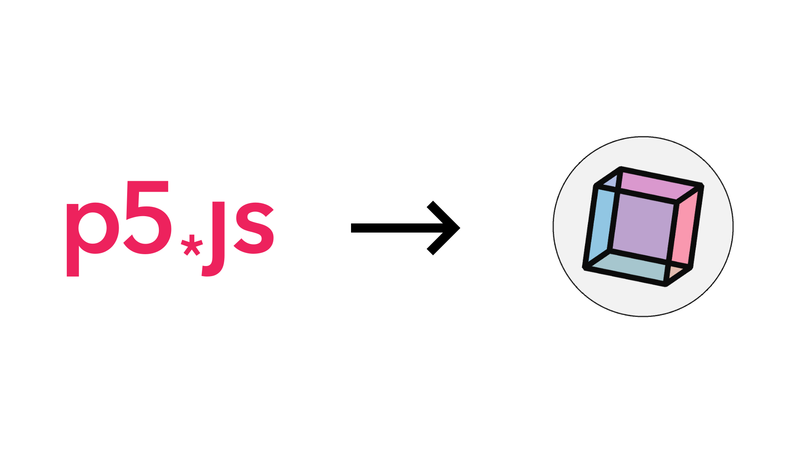
> https://py5coding.org

---

<!--
_backgroundColor: #EEE
_paginate: false
-->

> https://py5coding.org

---

# Introduction » Installation

---

<!--
_backgroundColor: #EEE
_paginate: false
-->
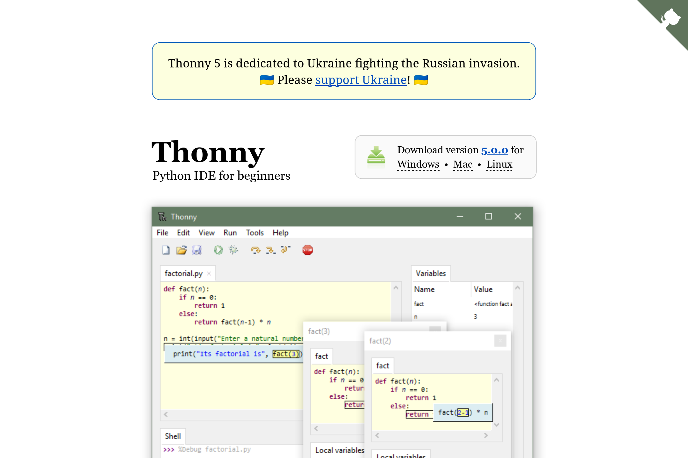
> https://thonny.org

---

<!--
_backgroundColor: #000
_paginate: false
-->
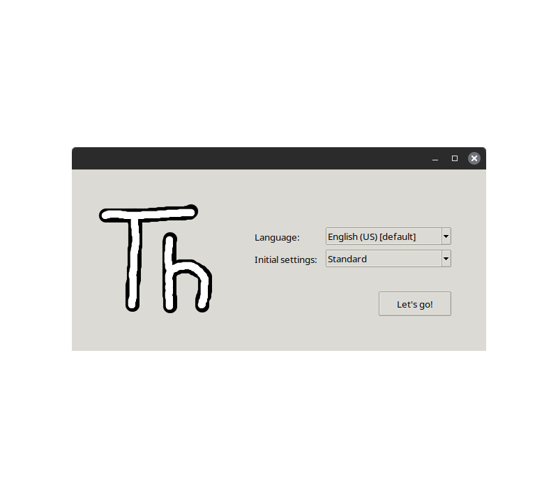

---

<!--
_backgroundColor: #000
_paginate: false
-->


---

<!--
_backgroundColor: #000
_paginate: false
-->
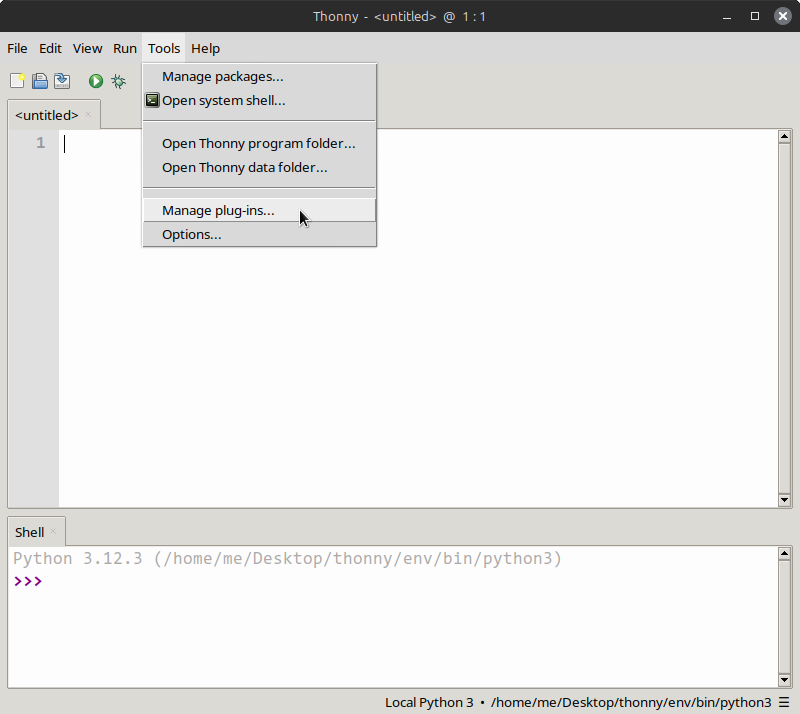

---

<!--
_backgroundColor: #000
_paginate: false
-->
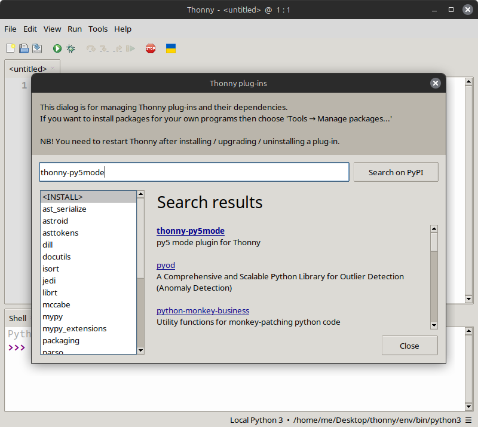

---

<!--
_backgroundColor: #000
_paginate: false
-->
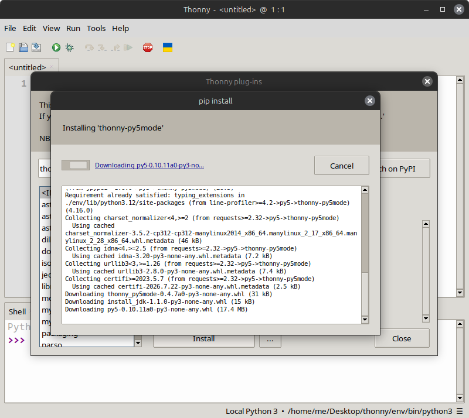

---

<!--
_backgroundColor: #000
_paginate: false
-->


---

<!--
_backgroundColor: #000
_paginate: false
-->
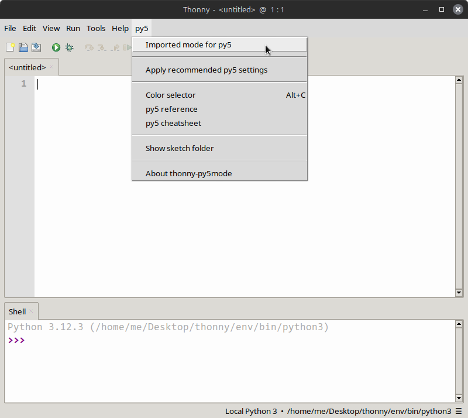

---

<!--
_backgroundColor: #000
_paginate: false
-->
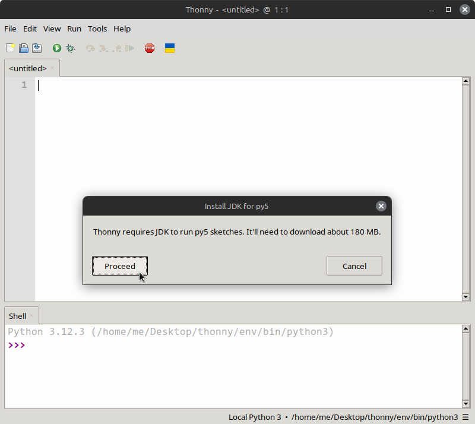

---

<!--
_backgroundColor: #000
_paginate: false
-->


---

<!--
_backgroundColor: #000
_paginate: false
-->
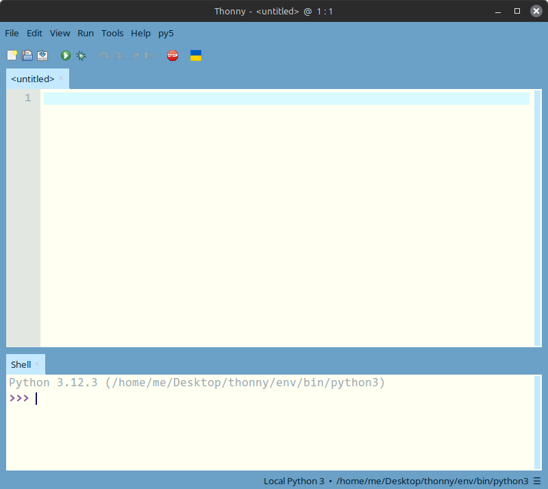

---

<!--
_backgroundColor: #000
_paginate: false
-->
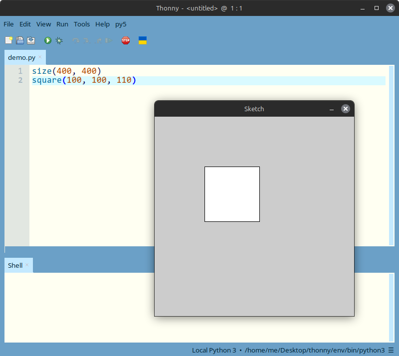

---

<!--
_backgroundColor: #000
_paginate: false
-->
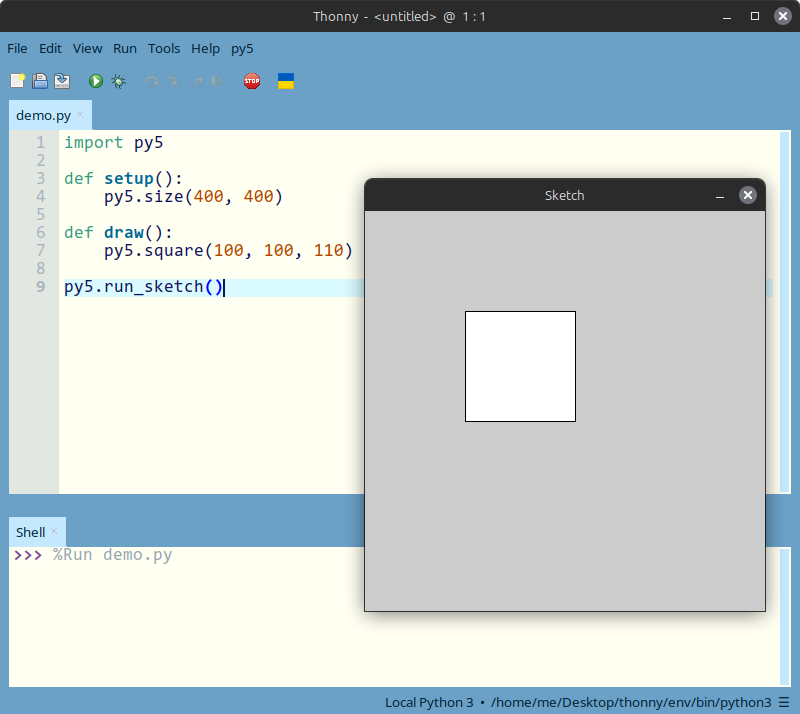

---


---

## The Big Picture » The Nature of Code

- Daniel Shiffman's book on simulating natural systems (2024 edition)
- Randomness » vectors » forces » particles » agents » physics » intelligence
- All examples written in **p5.js** (JavaScript)
<!--
- show of hands: who has worked through any nature of code chapters?
- the book builds up from simple random walks to neural networks and neuroevolution
-->

---
<!--
_backgroundColor: white
_paginate: false
-->
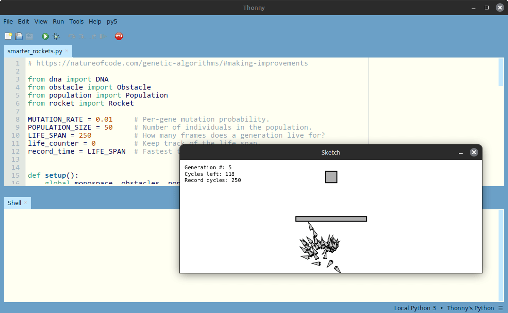
<!--
- a complete py5 port of the book's examples exists -- every chapter, ~100 sketches
- we'll use it as our map: it shows exactly where translation is trivial and where it isn't
-->

---

## The Big Picture » py5

- Python framework built on the **Processing** core (runs on the JVM)
- Same `setup()` / `draw()` model as p5.js
- *Imported mode*: py5 functions available with no explicit import

```python
# PY5 IMPORTED MODE CODE

def setup():
    size(640, 240)

def draw():
    background(255)
    circle(mouse_x, mouse_y, 48)
```
<!--
- the jvm point matters later -- it's what makes java library substitution possible
- the "PY5 IMPORTED MODE CODE" marker injects the py5 api into the module namespace
- to run: install thonny-py5mode and activate py5 -> imported mode in the editor
-->

---

## The Big Picture » Three Kinds of Translation

- **Direct** -- vectors, forces, particles: near line-for-line
- **Rethink** -- p5.js-exclusive libraries need substitutes
- **Simplify** -- Python idioms shorten the original JavaScript

| Original (p5.js) | Python substitute |
| --- | --- |
| Matter.js | Pymunk (Chipmunk2D wrapper) |
| toxiclibs.js | Toxiclibs *Java* library via the JVM |
| ml5.js | scikit-learn / bespoke NumPy |

---

# Thonny-py5mode
<!-- 
backgroundColor: teal
color: var(--color-background)
-->

---

## Thonny-py5mode » The Working Environment

- A plugin that integrates py5 into the **Thonny** Python editor
- Successor to the Processing IDE's discontinued *Python Mode*
- Handles setup for you -- installs a Java Runtime Environment (JRE)
- Officially maintained under the py5 organisation; recommended as *"the best py5 setup for beginners"*
<!--
- thonny is a beginner-focused python ide -- the plugin adapts it for creative coding
- the jre install is automatic, so students never touch java tooling directly
- full disclosure: thonny-py5mode is my own project, developed as part of my phd research
-->

---
<!--
_backgroundColor: white
_paginate: false
-->
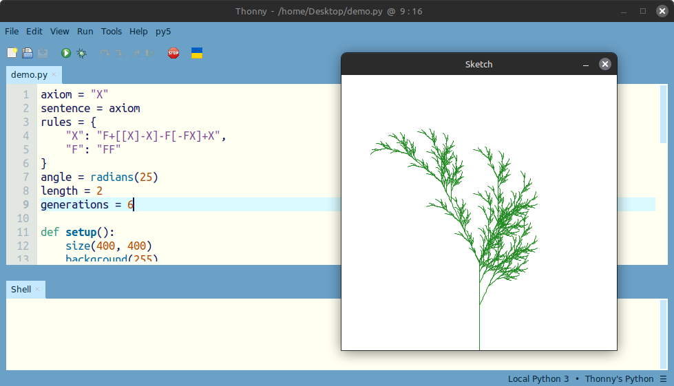
<!--
- thonny-py5mode in use, rendering an l-system fractal
- editor left, running sketch window right -- the workflow used for every port in this talk
-->

---

## Thonny-py5mode » The py5 Menu

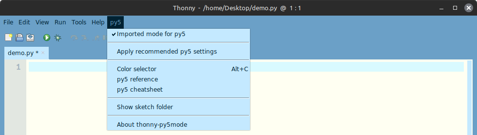

- Toggle **Imported mode** (no `import` statements or `py5.` prefixes)
- *Apply recommended py5 settings* -- Processing-inspired editor theme
- Colour selector, sketch-folder shortcut, links to reference & cheatsheet
<!--
- imported mode is what makes the nature of code ports read so cleanly
- static mode also works: omit setup/draw entirely for non-animated sketches
-->

---

## Thonny-py5mode » Editor Support

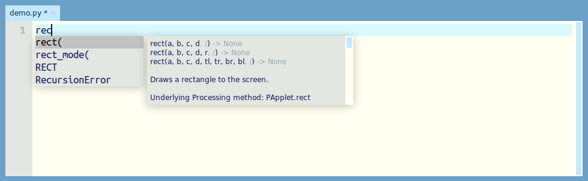

- Autocompletion and syntax highlighting for py5 commands
- Colour mixer dockable beside the editor
- Two-page printable **py5 cheatsheet** for quick reference
<!--
- highlighting py5 commands reduces syntactic errors for novices
- the cheatsheet covers sketch structure, colour, 2d primitives, typography, and control flow
-->

---

# Direct Translations
<!-- 
backgroundColor: indigo
color: var(--color-background)
-->

---

## Direct Translations » Same Skeleton, New Spelling

```javascript
// p5.js
function setup() {
  createCanvas(640, 240);
}
function draw() {
  circle(mouseX, mouseY, 48);
}
```
```python
# py5
def setup():
    size(640, 240)
def draw():
    circle(mouse_x, mouse_y, 48)
```
<!--
- the draw loop, frame rate, and event model all behave the same
- transformations too: push/pop, translate, rotate port unchanged
-->

---

## Direct Translations » Renames to Know

| p5.js | py5 | Why |
| --- | --- | --- |
| `createCanvas()` | `size()` | Processing heritage |
| `map()` | `remap()` | `map()` is a Python built-in |
| `mouseX`, `strokeWeight()` | `mouse_x`, `stroke_weight()` | snake_case |
| `random()`, `noise()` | `random()`, `noise()` | unchanged |
| `push()` / `pop()` | `push()` / `pop()` | unchanged |
<!--
- remap is the one that bites people: p5's map collides with python's built-in map
- everything else is a mechanical camelCase-to-snake_case conversion
-->

---

## Direct Translations » Randomness & Perlin Noise

```python
class Walker:

    def __init__(self):
        self.tx = 0
        self.ty = 10_000

    def step(self) -> None:
        # x- and y-position mapped from noise.
        self.x = remap(noise(self.tx), 0, 1, 0, width)
        self.y = remap(noise(self.ty), 0, 1, 0, height)
        self.tx += 0.01
        self.ty += 0.01
```
- Chapter 0 ports line-for-line: `noise()`, Gaussian, accept-reject
<!--
- note remap() again in real use
- note 10_000 -- python permits underscores in numeric literals for readability
- perlin noise behaves identically: same 0..1 range, same time-step technique
-->

---
<!--
_backgroundColor: white
_paginate: false
-->
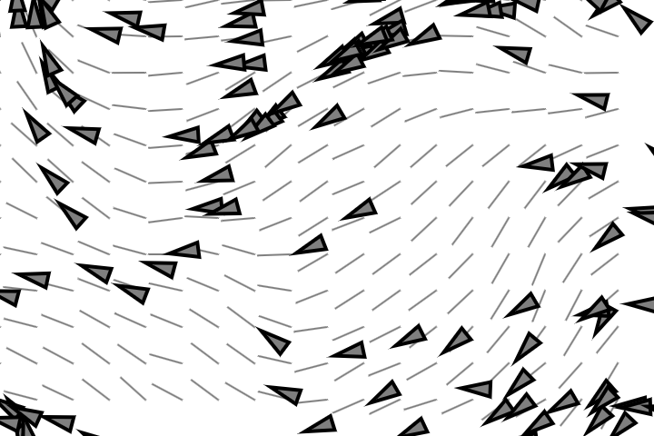
<!--
- a perlin-noise flow field -- the book's signature randomness visual
- identical output from the py5 port; the algorithm is untouched
-->

---

## Direct Translations » Vectors

```javascript
// p5.js -- createVector() must be called inside setup()
position = createVector(100, 100);
velocity = createVector(2.5, 2);
position.add(velocity);
```
```python
# py5 -- a real class, usable anywhere
position = Py5Vector2D(100, 100)
velocity = Py5Vector2D(2.5, 2)
position += velocity
```
<!--
- p5.Vector mutates via method calls: add, sub, mult
- Py5Vector overloads the arithmetic operators -- more on this in the simplify section
- separate 2D/3D classes: Py5Vector2D, Py5Vector3D
-->

---

## Direct Translations » Methods Become Attributes

```javascript
// p5.js
let mouse = createVector(mouseX, mouseY);
mouse.sub(center);
const m = mouse.mag();   // method call
```
```python
# py5
mouse = Py5Vector2D(mouse_x, mouse_y)
mouse -= center
m = mouse.mag            # plain attribute
```
<!--
- magnitude, heading and friends are properties in py5, not methods
- easy stumbling block: mouse.mag() raises TypeError -- float is not callable
-->

---

## Direct Translations » Classes: `this` Becomes `self`

```javascript
// p5.js
class Mover {
  constructor(x, y) {
    this.position = createVector(x, y);
  }
}
```
```python
# py5
class Mover:
    def __init__(self, x, y):
        self.position = Py5Vector2D(x, y)
```
- The Walker, Mover, Particle, Vehicle classes port almost mechanically
<!--
- constructor() becomes __init__(); implicit this becomes explicit self
- the book's object-oriented backbone survives translation intact
-->

---

## Direct Translations » Steering: Reynolds' `seek()`

```python
def seek(self, target: Py5Vector2D) -> Py5Vector2D:
    # Calculate the desired velocity to target at max speed.
    desired = target - self.position
    if desired.mag == 0: return Py5Vector2D()
    desired.normalize()
    desired.set_mag(self.max_speed)
    # Reynolds' formula for steering force.
    steer = desired - self.velocity
    steer.set_limit(self.max_force)
    return steer
```
- Seek, flee, wander, path following, flocking: all direct ports
<!--
- limit() becomes set_limit(), setMag() becomes set_mag() -- but the algorithm is untouched
- newton's-law physics model (apply_force accumulating acceleration) ports as-is
-->

---
<!--
_backgroundColor: white
_paginate: false
-->
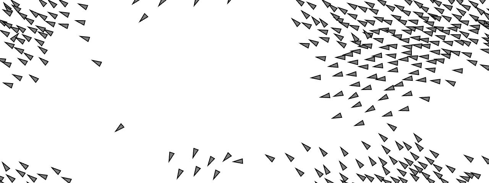
<!--
- flocking: separation + alignment + cohesion, straight from the book
- even the bin-lattice optimisation chapter has a py5 equivalent
-->

---

## Direct Translations » Recursion & Fractals

```python
def branch(length: float) -> None:
    line(0, 0, 0, -length)  # Draw the branch.
    translate(0, -length)   # Translate to the end.
    length *= 0.67

    if length > 2:          # Exit condition for the recursion!
        push()
        rotate(angle)
        branch(length)      # Branch to the right ...
        pop()
```
- `push()` / `pop()` / `translate()` / `rotate()` all behave identically
<!--
- recursion, cantor set, koch curve, l-systems: the fractals chapter is a pure direct port
- matrix-stack based drawing is a processing concept both frameworks share
-->

---
<!--
_backgroundColor: white
_paginate: false
-->
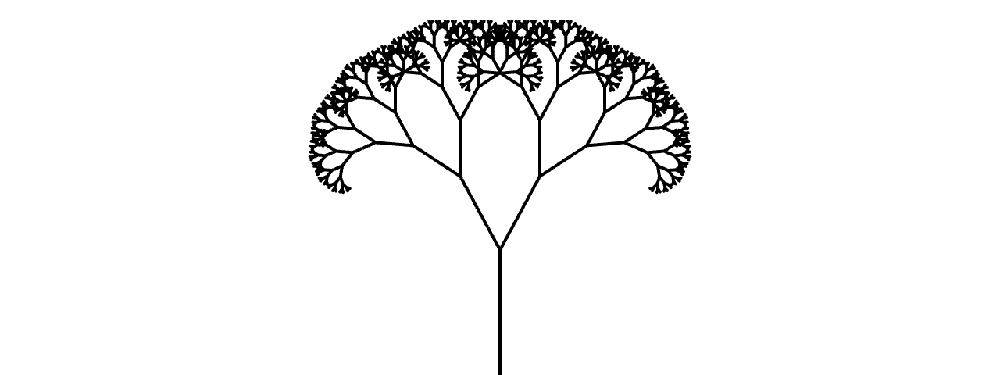
<!--
- the recursive tree, angle mapped from mouse_x -- identical in both languages
-->

---

# Rethinking Required
<!-- 
backgroundColor: midnightblue
color: var(--color-background)
-->

---

## Rethinking Required » Scope Is Different

```javascript
// p5.js -- outer variables just work
let position;
function draw() { position.add(velocity); }
```
```python
# py5 -- assignment needs an explicit declaration
def draw():
    global position
    position += velocity
```
- JavaScript closures reassign outer variables freely
- Python requires `global` for reassignment in `setup()` / `draw()`
<!--
- the single most common porting error: forgetting global, getting UnboundLocalError
- alternative designs: wrap state in a class, or mutate objects instead of reassigning
-->

---

## Rethinking Required » Deleting While Iterating

```javascript
// p5.js -- loop backward to splice safely
for (let i = particles.length - 1; i >= 0; i--) {
  particles[i].run();
  if (particles[i].isDead()) particles.splice(i, 1);
}
```
```python
# py5 -- same backward-loop technique works ...
for i in range(len(particles) - 1, -1, -1):
    particles[i].run()
    if particles[i].dead:
        del particles[i]
```
<!--
- the particle systems chapter's central trick carries over directly
- but python has a nicer answer -- hold that thought for the simplify section
-->

---

## Rethinking Required » Physics: Matter.js » Pymunk

```python
from pymunk import Body, moment_for_box, Poly, Space

engine = Space()                          # world/engine = Space
engine.gravity = (0, 1.0 * SCALE_GRAVITY) # calibration constant
```
- Matter.js is JavaScript-only » **Pymunk** (Chipmunk2D wrapper)
- Pymunk separates **Body** (physics) from **Shape** (collision skin)
- No `Render` module -- you draw the bodies yourself in `draw()`
<!--
- matter.js bundles a renderer; with pymunk the sketch reads body positions and draws shapes manually
- body = physics, shape = collision skin; multiple shapes can attach to one body
-->

---

## Rethinking Required » Pymunk: Calibrating Two Engines

```python
"""
Since the Matter.js and Pymunk engines use different units
and solvers, these values provide an *approximate* conversion
for matching visual behavior.
"""
SCALE_GRAVITY = 900.0
FPS = 60.0
SCALE_TIME = FPS
SCALE_VELOCITY = SCALE_TIME
SCALE_FRICTION = SCALE_TIME
```
- Same simulation *concepts*, different units and solvers
- Constants make py5 sketches visually match the book's figures
<!--
- this is the real cost of substitution: the api maps, but behavior needs tuning
- gravity of 1 in matter.js is roughly 900 in pymunk's units at 60fps
-->

---

## Rethinking Required » Toxiclibs: Skip the Port, Use the Original

```python
# The actual Java library, imported straight into Python
from toxi.geom import Vec2D, Rect
from toxi.physics2d import VerletPhysics2D, VerletSpring2D

physics = VerletPhysics2D()
physics.setWorldBounds(Rect(0, 0, width, height))
```
- toxiclibs.js is a *port* of a Java library -- py5 runs on the JVM
- So Python can use the **original Java Toxiclibs** directly
- Java naming leaks through: `setWorldBounds`, `addBehavior`
<!--
- this is the surprise win of the jvm: no substitute needed, just the upstream library
- tradeoff: camelCase java api inside snake_case python code
-->

---

## Rethinking Required » Wrapping Java Objects

```python
class Particle:  # Python wrapper around a Java VerletParticle2D

    def __init__(self, x, y, r):
        self.p = VerletParticle2D(x, y)  # underlying Java object

# Must add everything to the world -- pass the Java object via .p
physics.addParticle(particle_1.p)
physics.addSpring(VerletSpring2D(particle_1.p, particle_2.p, length, strength))
```
- Python classes wrap Java particles to add `show()` methods
- Gotcha: the *world* needs the underlying Java object, not the wrapper
<!--
- the book subclasses VerletParticle2D in js; in py5 composition is cleaner than subclassing java classes
- forgetting .p is the classic error here -- type mismatch at the java boundary
-->

---
<!--
_backgroundColor: white
_paginate: false
-->

<!--
- toxiclibs soft string: verlet particles + springs, rendered with py5's curve_vertex
-->

---

## Rethinking Required » Machine Learning: ml5.js » scikit-learn

```python
from sklearn.neural_network import MLPClassifier

classifier = MLPClassifier(hidden_layer_sizes=(16,), max_iter=2500)
classifier.fit(inputs, outputs)   # trains before setup() runs
```
- ml5.js trains asynchronously » callbacks (`whenTrained`, ...)
- scikit-learn trains **synchronously, before the window opens**
- Callbacks disappear entirely; the shell replaces ml5's "Visor"
<!--
- async is the deepest rethink: the browser cannot block, python happily can
- ch10's perceptron is hand-rolled in both languages -- that one is a direct port
-->

---

## Rethinking Required » Neuroevolution: a Bespoke NumPy Brain

```python
class Brain:
    """Vectorized NumPy brain with GA helpers."""

    def __init__(self, inputs, outputs, hidden=8):
        self.w_ih = _rng.uniform(-1.0, 1.0, (hidden, inputs))
        self.b_h  = _rng.uniform(-1.0, 1.0, (hidden,))
        # ... w_ho, b_o ...

    def forward(self, inputs):
        h = np.tanh(self.w_ih @ x + self.b_h)
        return (self.w_ho @ h + self.b_o).tolist()
```
- ml5's `neuroEvolution` has no drop-in substitute » write one (~50 lines)
<!--
- forward pass is two matrix multiplications -- numpy's @ operator
- ga helpers (crossover, mutate) operate directly on the weight arrays
- sometimes "rethinking" means realising the library was hiding very little
-->

---

# Where Python Simplifies
<!-- 
backgroundColor: darkred
color: var(--color-background)
-->

---

## Where Python Simplifies » Operator Overloading

```javascript
// p5.js -- verbose static/method calls
let force = p5.Vector.sub(attractor, mover);
force.normalize();
force.mult(strength);
mover.acceleration.add(force);
```
```python
# py5 -- reads like the maths
force = (attractor - mover).norm * strength
mover.acceleration += force
```
<!--
- the vector algebra chapters are where python shines brightest
- normalize as .norm property, magnitude as .mag -- expressions compose naturally
-->

---

## Where Python Simplifies » Comprehensions

```javascript
// p5.js
let training = [];
for (let i = 0; i < 2000; i++) {
  training.push([random(-width/2, width/2), random(-height/2, height/2), 1]);
}
```
```python
# py5
training = [
  [random(-width / 2, width / 2), random(-height / 2, height / 2), 1]
  for _ in range(2000)
]
```
<!--
- training-data setup and particle spawning collapse into single expressions
-->

---

## Where Python Simplifies » Filtering Particles

```javascript
// p5.js -- backward loop + splice
for (let i = particles.length - 1; i >= 0; i--) {
  if (particles[i].isDead()) particles.splice(i, 1);
}
```
```python
# py5 -- rebuild the list declaratively
self.particles = [p for p in self.particles if not p.dead]
```
- The chapter 4 index-juggling disappears entirely
<!--
- callback to the rethinking section: the backward loop works, but this is the pythonic answer
- isDead() method becomes a dead property -- same attribute-over-method pattern as .mag
-->

---

## Where Python Simplifies » Slices: Cellular Automata

```javascript
// p5.js
let nextgen = cells.slice();
```
```python
# py5
next_gen = cells[:]                # copy a generation
cells = [0] * (width // W)         # build a row of dead cells
left, me, right = cells[i - 1], cells[i], cells[i + 1]
```
- List building, copying, and unpacking shrink the Wolfram CA code
<!--
- tuple unpacking makes the neighborhood read like the book's prose
- integer division // avoids the js-style floor() call for grid math
-->

---

## Where Python Simplifies » Small Quality-of-Life Wins

- `position += velocity` -- augmented assignment on vectors
- `10_000` -- readable numeric literals
- Type hints: `def step(self) -> None:` documents intent
- No `let` / `const` / semicolons / braces
- Synchronous ML training -- no callback pyramids
<!--
- none of these are transformative alone; together the ports are consistently shorter
- type hints are optional but the py5 port uses them throughout
-->

---

# Where AI Helps (and Where It Doesn't)
<!-- 
backgroundColor: saddlebrown
color: var(--color-background)
-->

---

## Where AI Helps » The Mechanical 80%

- **Renaming passes**: camelCase » snake_case, `let/const` » nothing, `this` » `self` -- ideal LLM work
- **Boilerplate**: wrapper classes, type hints, docstrings
- **API explanation**: "what's the Pymunk equivalent of `Bodies.rectangle()`?"
- Direct-translation chapters (0-5, 8) are near-perfect AI territory: the algorithm is unchanged, only the spelling moves
<!--
- an llm given a p5.js sketch and asked for py5 typically produces a runnable first draft for the direct chapters
- the book's heavy commenting helps: comments translate too, keeping the port aligned with the text
-->

---

## Where AI Doesn't » Hallucination & Judgement

- **Hallucinated APIs**: `.mag()` as a method, invented py5 functions, `createVector()` habits bleeding through
- **Substitution decisions**: *which* physics library? Pymunk vs. the original Java Toxiclibs is a judgement call AI won't make for you
- **Calibration**: `SCALE_GRAVITY = 900.0` came from empirical tuning, not translation
- **JVM boundary quirks**: passing `.p` (the Java object) instead of the wrapper
<!--
- models trained mostly on processing/p5.js confuse the three apis constantly
- calibration constants can only be found by running both sketches side by side and comparing
- the toxiclibs-via-jvm route is non-obvious: an llm defaults to suggesting a python physics library instead
-->

---

## Where AI Doesn't » Eyes on the Sketch

- These are *visual* programs -- correctness means **matching the book's figures**
- AI can't watch the sketch run: jittery motion, wrong gravity feel, drifting flocks all pass a code review
- Working loop: **AI drafts » you run » compare against the p5.js original » tune**
- The p5.js editor links beside every ported sketch exist for exactly this
<!--
- example: a pymunk port that compiles and runs but falls at the wrong speed -- no error, just wrong physics
- the visual comparison step is where all the calibration constants were discovered
-->

---

# Takeaways
<!-- 
backgroundColor: darkolivegreen
color: var(--color-background)
-->

---

## Takeaways

- **Most of the book translates directly** -- randomness through fractals is near line-for-line
- **Renames to remember**: `map()` » `remap()`, camelCase » snake_case, `.mag()` » `.mag`
- **The `global` keyword** is the most common porting stumble
- **Library substitution**: Pymunk for Matter.js, original Java Toxiclibs via the JVM, scikit-learn / NumPy for ml5.js
- **Python often simplifies**: operator overloading, comprehensions, slices
- **AI drafts, you verify**: great at renaming passes, weak on library judgement and visual correctness
<!--
- the ecosystem swap is the interesting part: sometimes a wrapper (pymunk), sometimes the original library (toxiclibs), sometimes diy (numpy brain)
-->

---

## Try It Yourself

- Install **Thonny-py5mode**, activate *py5 » Imported mode*
- Port a chapter 1 or 2 sketch by hand -- it's mostly renaming
- Compare against the complete **py5-nature-of-code** port
- Read the book free online: natureofcode.com
<!--
- suggested exercise: port example 2.6 (attraction) and then simplify it with operator overloading
- the py5 port's readme links every sketch to its p5.js editor original
-->

---

## *End*
<!-- 
paginate: false 
backgroundColor: black
color: var(--color-background)
-->
