---

marp: true
theme: TorrensUni
notes: ...

---

# ***The Nature of Code, but Python***
<!-- 
_backgroundColor: black
_backgroundImage: "url(title_bg.png)"
_backgroundSize: "cover"
_color: var(--color-background)
-->
<!--
- a session exploring how the nature of code (p5.js) translates into python using py5
-->

---

# Introduction
<!-- 
paginate: true
backgroundColor: darkslategrey
color: var(--color-background)
-->

---

<!--
_backgroundColor: white
_paginate: false
-->
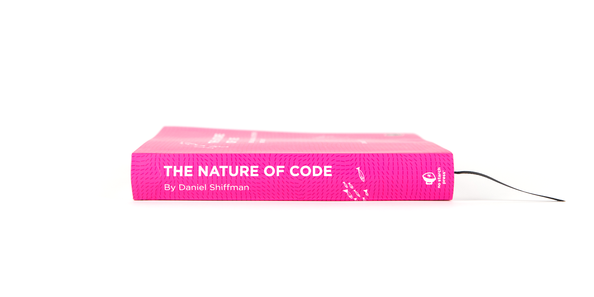
> https://tisch.nyu.edu/itp/news/fall-2024/daniel-shiffman--itp-faculty-member--launches-new-book---the-nat
<!--
- note this is the 2nd edition (no starch press)
- show of hands: who has worked through any nature of code chapters?
- for anybody unfamiliar: the book builds up from simple random walks to vectors to physics to neural networks & neuroevolution, and everything between
- as audience likely knows, this book is (p5.)js-based ... [NEXT SLIDE]
-->

---

<!--
_backgroundColor: black
_class: lead
_color: var(--color-background)
_paginate: false
-->
***Think:**<br />Python wearing a Processing costume,   
and nobody at the Nature of Code party notices.*
<!--
- the next few slides give a quick sense of the final outcome (a sample from each chapter)
- as we flip through, notice three things:
- 1. the environment (thonny) looks nearly identical to the classic processing ide
- 2. look closer at the editor, though, and it's pure python
- 3. the code reads almost line-for-line like the p5.js originals, producing identical visual results
- ... [NEXT SLIDES]
-->

---

<!--
_backgroundColor: black
_paginate: false
-->
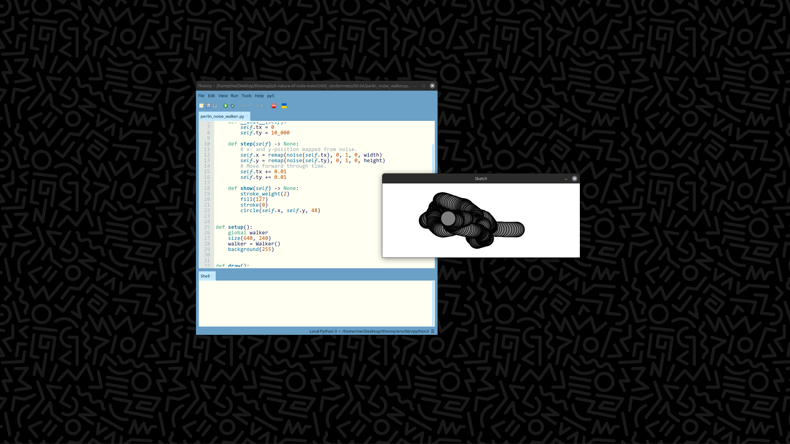
> 00.06 (perlin_noise_walker.py)

---

<!--
_backgroundColor: black
_paginate: false
-->
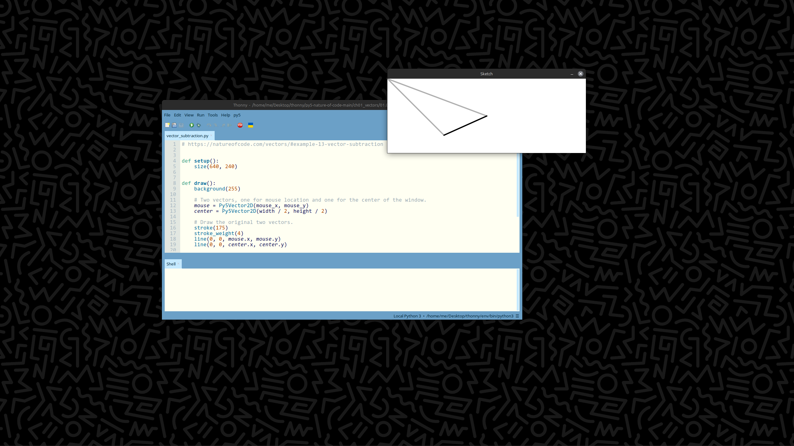
> 01.04 (vector_multiplication.py)

---

<!--
_backgroundColor: black
_paginate: false
-->
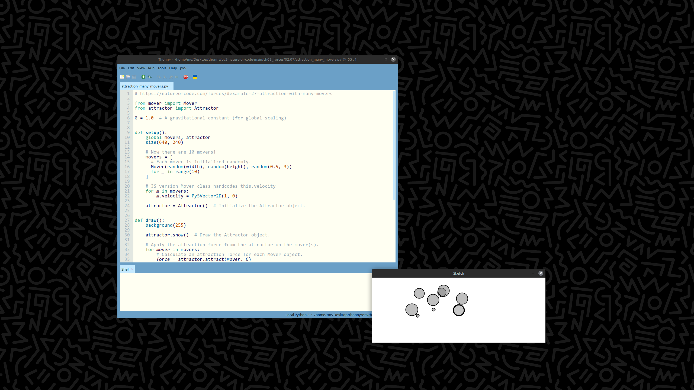
> 02.07 (attraction_many_movers.py)

---

<!--
_backgroundColor: black
_paginate: false
-->
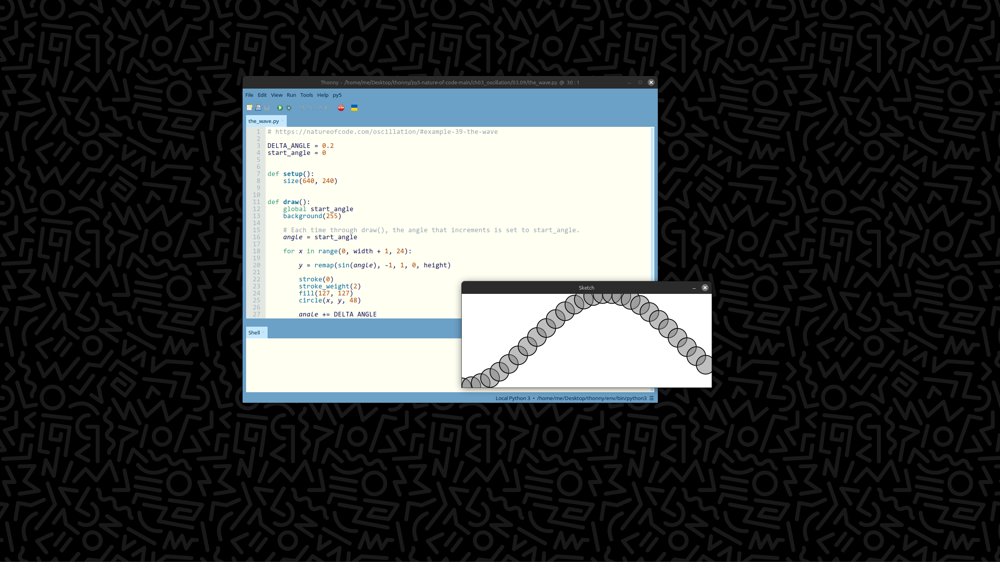
> 03.09 (the_wave.py)

---

<!--
_backgroundColor: black
_paginate: false
-->
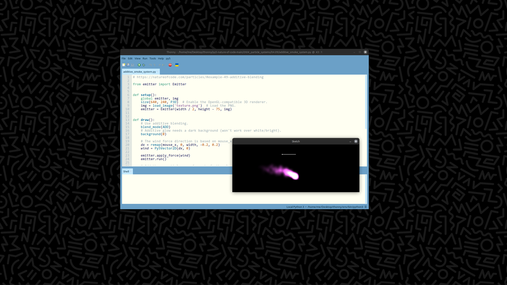
> 04.09 (additive_smoke_system.py)

---

<!--
_backgroundColor: black
_paginate: false
-->
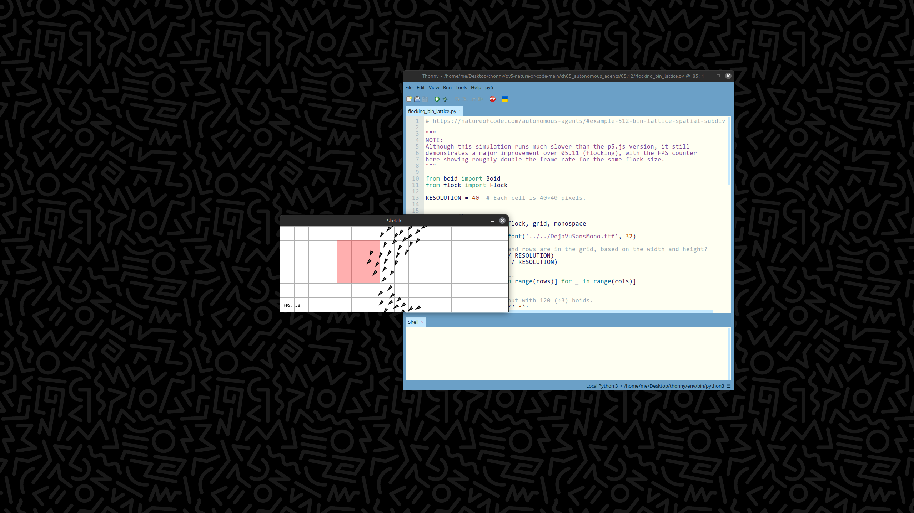
> 05.12 (flocking_bin_lattice.py)

---

<!--
_backgroundColor: black
_paginate: false
-->
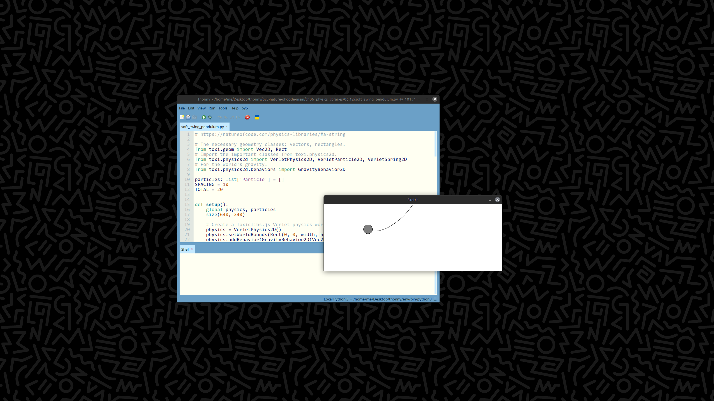
> 06.12 (soft_swing_pendulum.py)

---

<!--
_backgroundColor: black
_paginate: false
-->
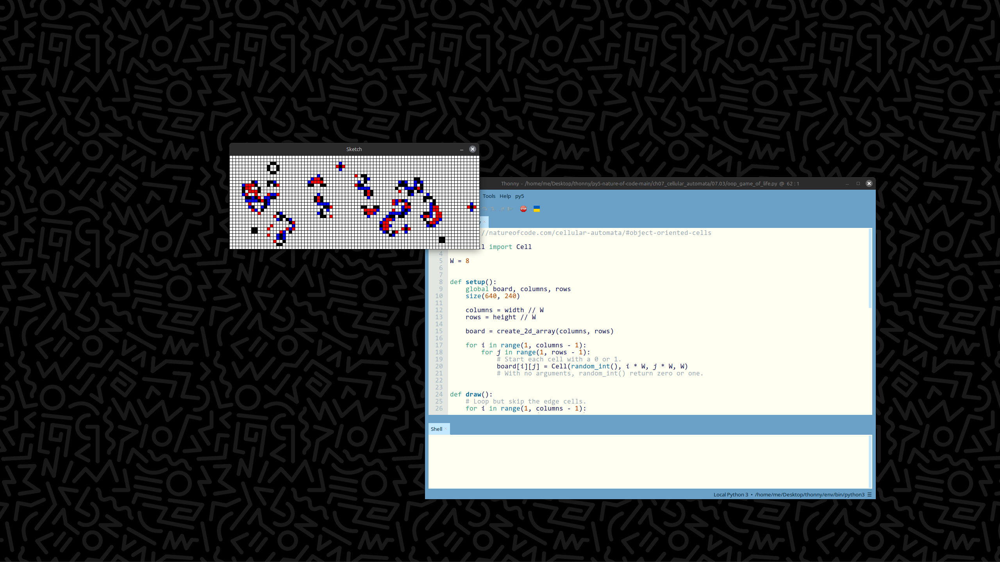
> 07.03 (oop_game_of_life.py)

---

<!--
_backgroundColor: black
_paginate: false
-->
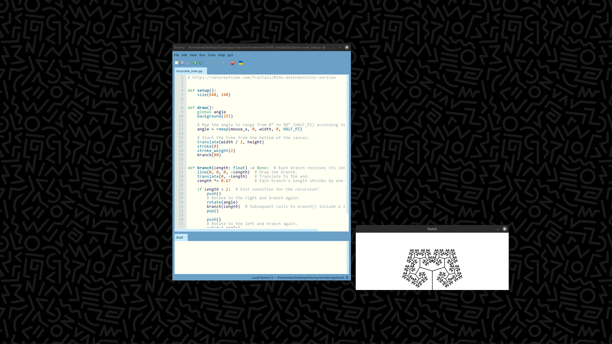
> 08.06 (recursive_tree.py)

---

<!--
_backgroundColor: black
_paginate: false
-->
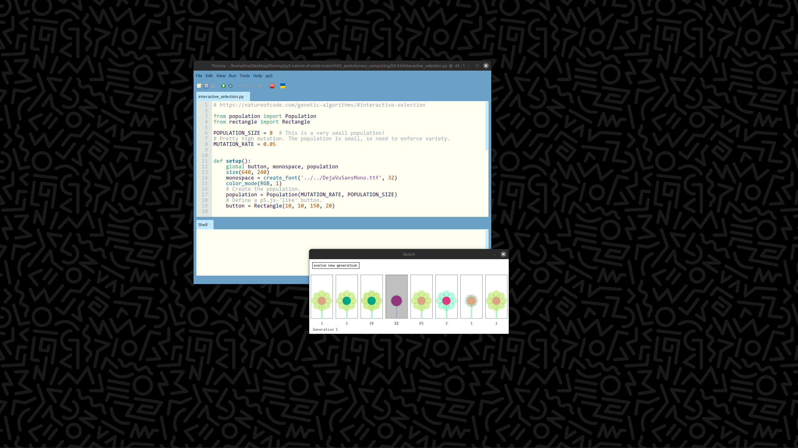
> 09.04 (interactive_selection.py)

---

<!--
_backgroundColor: black
_paginate: false
-->
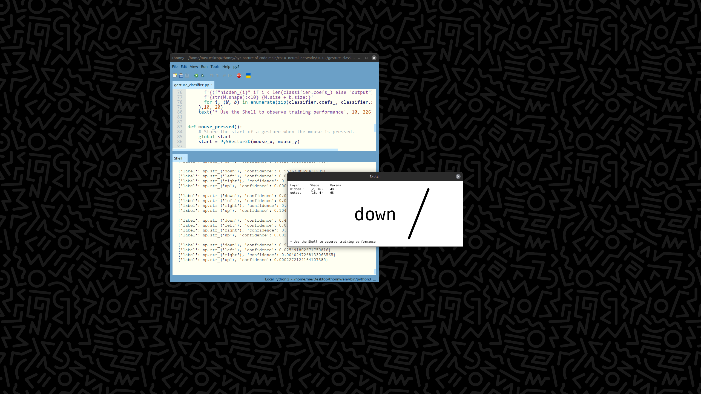
> 10.02 (gesture_classifier.py)

---

<!--
_backgroundColor: black
_paginate: false
-->
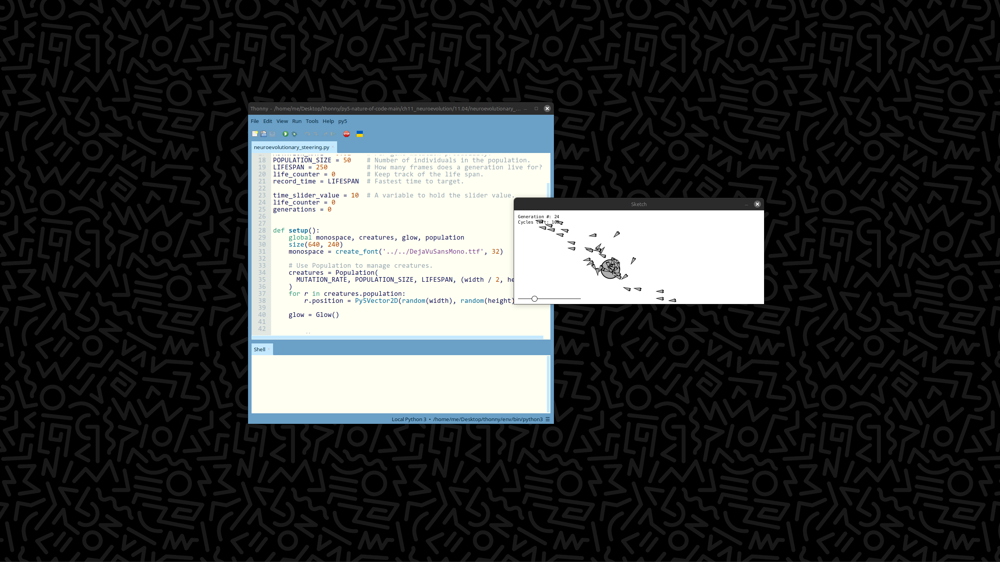
> 11.04 (neuroevolutionary_steering.py)

---

## Introduction » Setup
*JS to Python, and IDE configuration ...*
<!--
- [NEXT SLIDE]
-->

---

<!--
_backgroundColor: #EEE
_paginate: false
-->
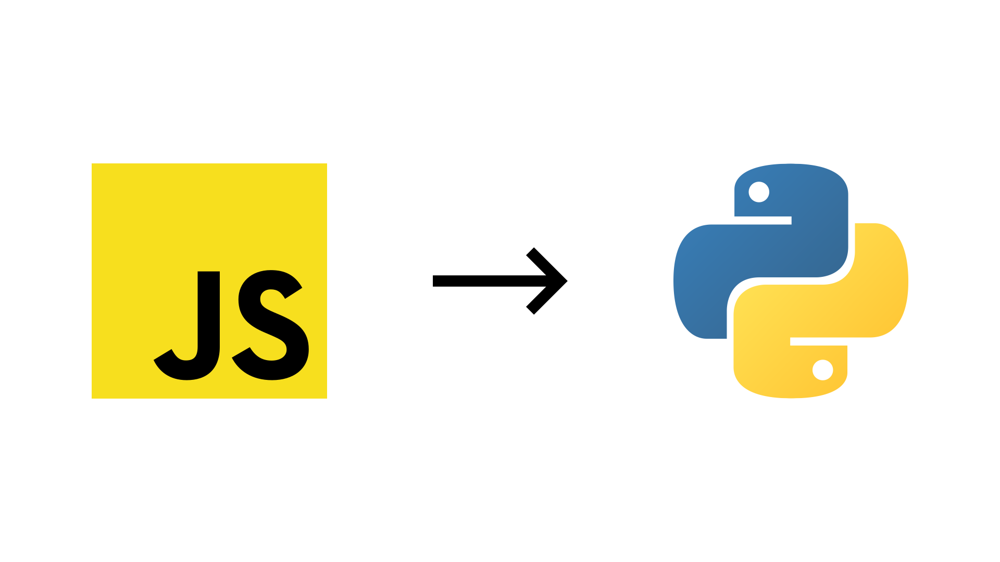
> https://py5coding.org
<!--
- really, both languages can do the same things, but it's libraries/frameworks that matter
- so, in order to port from javascript to python ... [NEXT SLIDE]
-->

---

<!--
_backgroundColor: #EEE
_paginate: false
-->

> https://py5coding.org
<!--
- i opted to use py5 as a python processing framework
- of course, there are other solutions (processing.py, p5py, pyp5js, a few others), each with its pros/cons
-->

---

<!--
_backgroundColor: #EEE
_paginate: false
-->
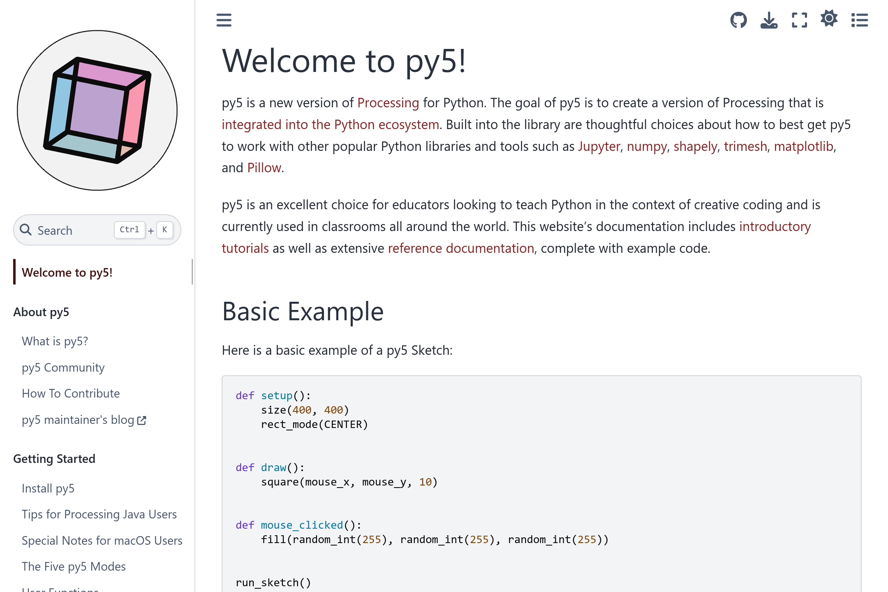
> https://py5coding.org
<!--
- for those who are unfamiliar with py5, find out more at py5coding.org
-->

---

## Introduction » py5 Features
* <highlight>Modern Python:</highlight> full Python 3 support, including C-extension libraries,  
  including native integration with NumPy, Pillow, Shapely, etc.
* <highlight>Processing engine:</highlight> Java Processing graphics backend via JPype,  
  and can load and use many existing Java Processing libraries
* <highlight>Any editor:</highlight> works in Jupyter Notebooks, VS Code, etc.  
  with flexible modes: static & imported (beginner), module, or class
* <highlight>Fun features to explore:</highlight> pixel manipulation using NumPy arrays,  
  live coding, Matplotlib, Shapely geometries, Pandas/Polars etc.

---

## Introduction » Run py5
* <highlight>Standard python script:</highlight> VS Code, PyCharm, terminal, etc.
* <highlight>Jupyter notebook:</highlight> via standard ipykernel, or py5 kernel
* <highlight>Thonny-py5mode:</highlight> Thonny IDE + py5 plugin <span style="color:orange;font-weight:bold">🠄</span>
<!--
- discuss pros/cons of each:
- standard -- any editor; requires manual environment/pip setup
- jupyter -- notebook format mixing different cells (good for teaching?); perhaps not your style
- thonny -- familiar to legacy processing users; feels 'dedicated'; perhaps not your style
-->

---

<!--
_backgroundColor: #EEE
_paginate: false
-->

> https://thonny.org
<!--
- find out more at thonny.org 
- features include ... [NEXT SLIDE]
-->

---

## Introduction » Thonny Features
* <highlight>Beginner-focused:</highlight> minimal, uncluttered interface designed for learning
* <highlight>Bundled Python:</highlight> includes a built-in Python 3 runtime
* <highlight>Cross-platform:</highlight> runs on Linux, macOS, Windows
* <highlight>Fully portable:</highlight> runs directly from a USB drive without admin rights
* <highlight>Several neat panels:</highlight> interactive shell, plotter, outline, and more
<!--
- but thonny won't handle py5 natively ...
- so this is where the thonny-py5mode plugin enters the picture ... [NEXT SLIDE]
-->

---

## Introduction » Thonny-py5mode Installation
*A plugin that turns the Thonny IDE into a Python 3 ~~shameless ripoff~~ replacement for the original Processing IDE.*
<br /><hr style="color:rgba(255,255,255,0.3)" />
<highlight>Process</highlight><br />

1. Download and run Thonny
2. Add plugin
<!--
- it's easy ... [NEXT SLIDE]
-->

---

<!--
_backgroundColor: black
_paginate: false
-->
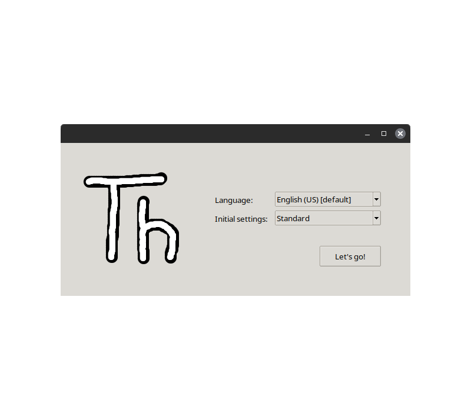
<!--
- this appears upon downloading thonny and running the first time
-->

---

<!--
_backgroundColor: black
_paginate: false
-->
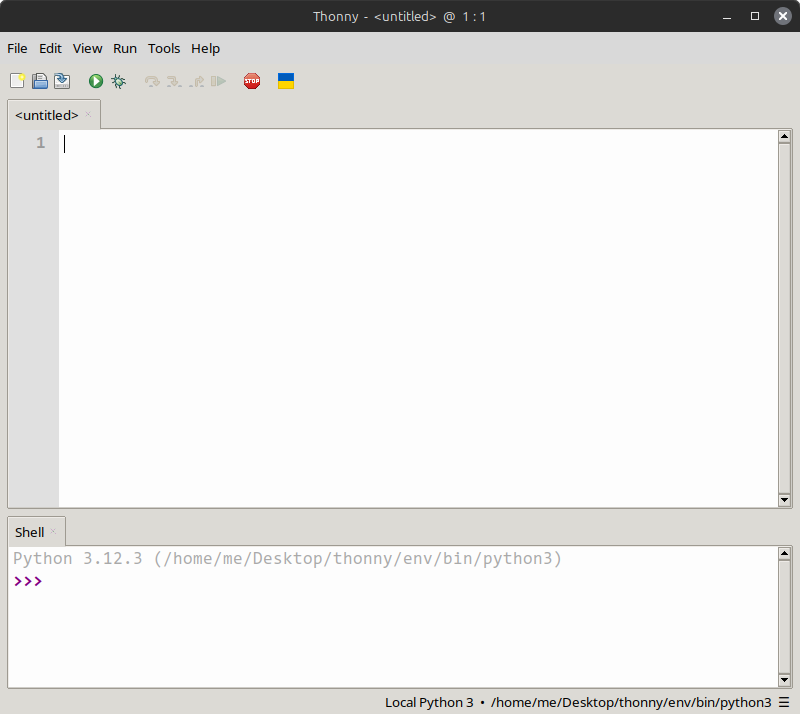
<!--
- note the simple application layout
-->

---

<!--
_backgroundColor: black
_paginate: false
-->
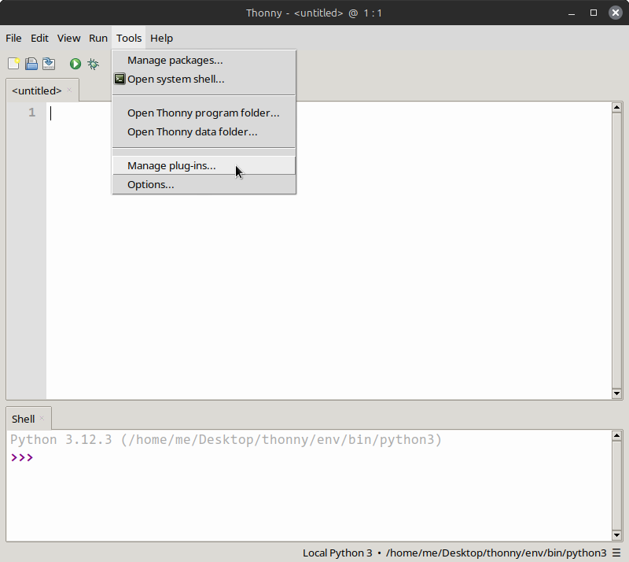

---

<!--
_backgroundColor: black
_paginate: false
-->


---

<!--
_backgroundColor: black
_paginate: false
-->


---

<!--
_backgroundColor: black
_paginate: false
-->
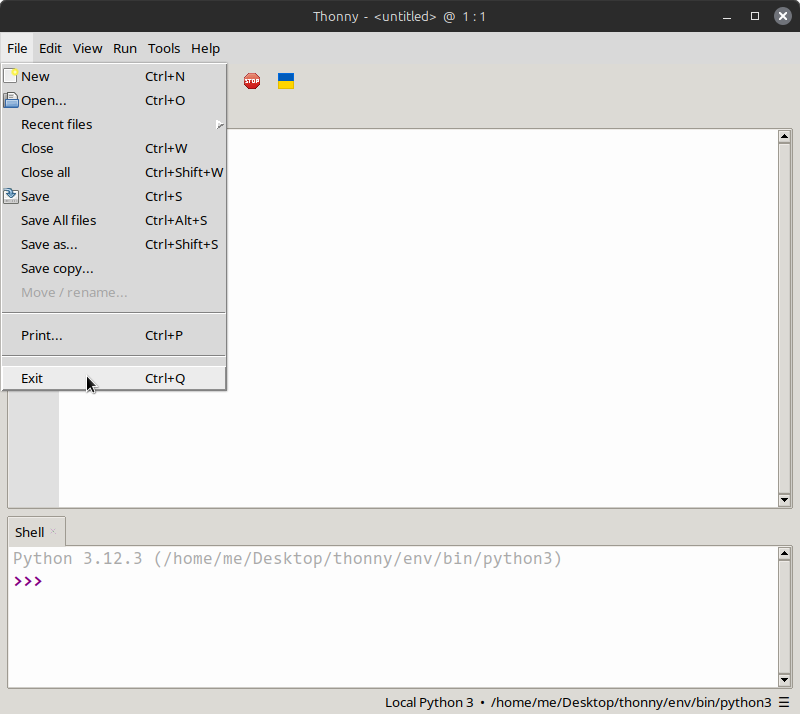

---

<!--
_backgroundColor: black
_paginate: false
_class: lead
-->
*... restarting ...*

---

<!--
_backgroundColor: black
_paginate: false
-->

<!--
- you don't *have to use* imported mode, but this means:
- no import line(s) required
- no py5. prefix for every method
- more beginner-friendly
- so, largely matches traditional processing and p5.js syntax
- easier porting (to py5)
- (so, basically, it's more like processing!)
-->

---

<!--
_backgroundColor: black
_paginate: false
-->

<!--
- (recall that py5 is running on java processing)
- if java is not detected, it'll download and install a local version
-->

---

<!--
_backgroundColor: black
_paginate: false
-->

<!--
- optional step to apply processing colour scheme and few other settings
-->

---

<!--
_backgroundColor: black
_paginate: false
-->


---

<!--
_backgroundColor: black
_paginate: false
-->
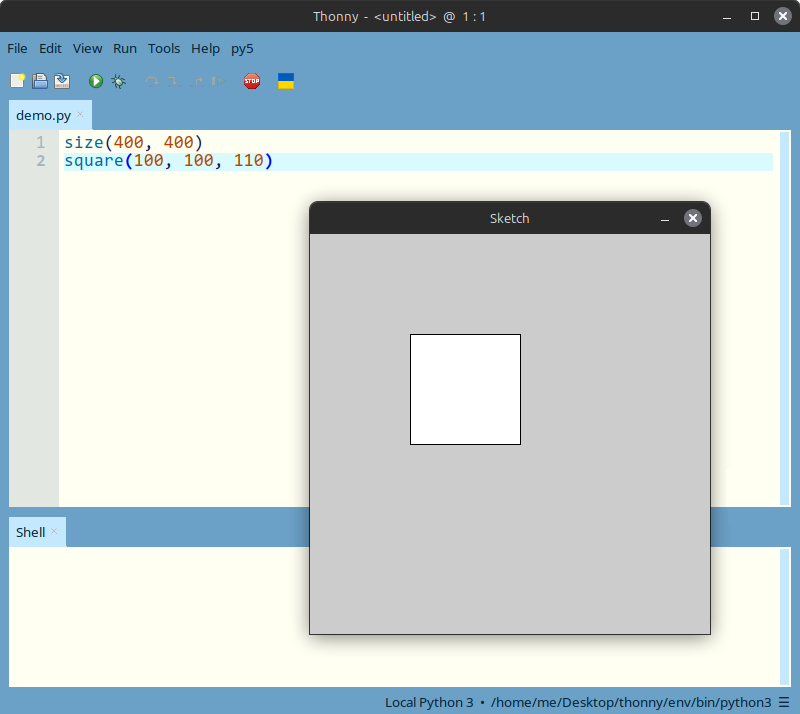
<!--
- just like processing, it has a static mode (not available in p5.js?)
- (of course, there are setup and draw functions for animated sketches)
-->

---

<!--
_backgroundColor: black
_paginate: false
-->

<!--
- (unchecking imported mode in the graphic)
- as i mentioned earlier, there is also a module mode
-->

---

<!--
_backgroundColor: black
_paginate: false
-->
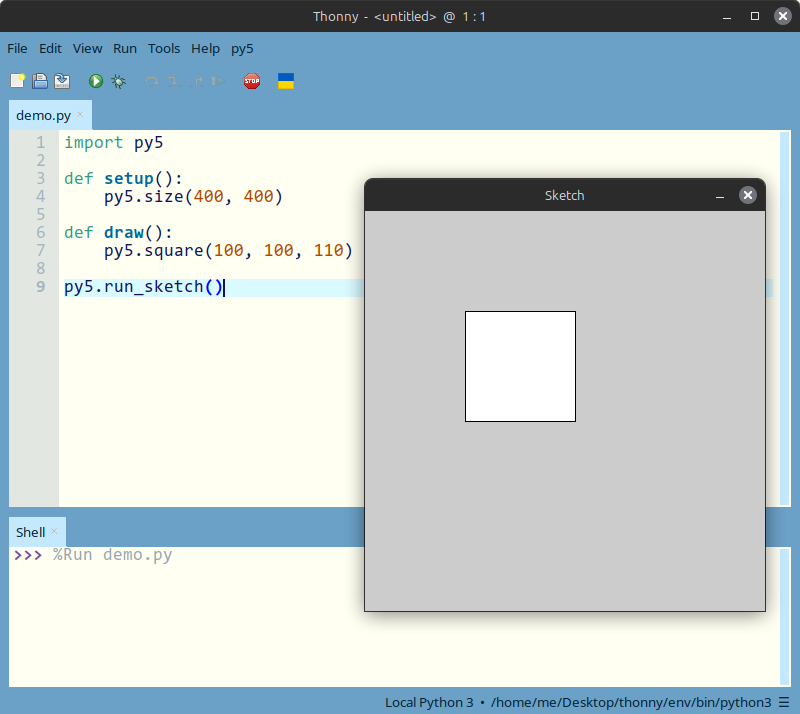
<!--
- note: import line, py5 prefixes, run_sketch method
-->

---

# py5
<!-- 
paginate: true
backgroundColor: maroon
color: var(--color-background)
-->
<!--
- to understand the porting process and requirements, a short py5 intro is necessary
-->

---

## py5 » Porting Approach
<b style="font-family:monospace;font-weight:bold">1</b>
<highlight>Translate Directly</highlight>  
<smaller>Vectors, forces, particles: *near* line-for-line</smaller>

---

## py5 » Porting Approach
<b style="font-family:monospace;font-weight:bold">1</b>
<highlight>Translate Directly</highlight>  
<smaller>Vectors, forces, particles: *near* line-for-line</smaller>

<b style="font-family:monospace;font-weight:bold">2</b>
<highlight>Rethink Logic</highlight>
<smaller>Language differences and library substitutions</smaller>

---

## py5 » Porting Approach
<b style="font-family:monospace;font-weight:bold">1</b>
<highlight>Translate Directly</highlight>  
<smaller>Vectors, forces, particles: *near* line-for-line</smaller>

<b style="font-family:monospace;font-weight:bold">2</b>
<highlight>Rethink Logic</highlight>
<smaller>Language differences and library substitutions</smaller>

<b style="font-family:monospace;font-weight:bold">3</b>
<highlight>Simplify Code</highlight>
<smaller>Python idioms to potentially simplify JS</smaller>

---

# 1. Translate Directly
<!-- 
backgroundColor: indigo
color: var(--color-background)
-->

---

## 1. Translate Directly » py5 Naming
```javascript
// p5.js
function setup() {
  createCanvas(640, 240);
}
function draw() {
  circle(mouseX, mouseY, 48);
}
```

<hr style="color:rgba(255,255,255,0.3)" />

```python
# py5
def setup():
    size(640, 240)
def draw():
    circle(mouse_x, mouse_y, 48)
```

---

## 1. Translate Directly » Key Renames to Know
<table style="width:100%;border:none;font-size:0.9em">
  <tr style="background-color:rgba(0,0,0,0.3)">
    <td style="border-color:rgba(0,0,0,0.3)">p5.js</td>
    <td style="border-color:rgba(0,0,0,0.3)">py5</td>
    <td style="border-color:rgba(0,0,0,0.3)">Why</td>
  </tr>
  <tr style="background:none">
    <td style="border-color:rgba(0,0,0,0.3);background:transparent"><code>createCanvas()</code></td>
    <td style="border-color:rgba(0,0,0,0.3);background:transparent"><code>size()</code></td>
    <td style="border-color:rgba(0,0,0,0.3);background:transparent">Processing Java</td>
  </tr>
  <tr style="background:none">
    <td style="border-color:rgba(0,0,0,0.3);background:transparent"><code>mouseX</code>, <code>strokeWeight()</code></td>
    <td style="border-color:rgba(0,0,0,0.3);background:transparent"><code>mouse_x</code>, <code>stroke_weight()</code></td>
    <td style="border-color:rgba(0,0,0,0.3);background:transparent">snake_case</td>
  </tr>
  <tr>
    <td style="border-color:rgba(0,0,0,0.3);background:transparent"><code>map()</code></td>
    <td style="border-color:rgba(0,0,0,0.3);background:transparent"><code>remap()</code></td>
    <td style="border-color:rgba(0,0,0,0.3);background:transparent">Python built-in</td>
  </tr>
  <tr style="background:none">
    <td style="border-color:rgba(0,0,0,0.3);background:transparent">NOC <code>next</code>, <code>len</code> variables</td>
    <td style="border-color:rgba(0,0,0,0.3);background:transparent"><code>next_</code>, <code>len_</code></td>
    <td style="border-color:rgba(0,0,0,0.3);background:transparent">Python built-in</td>
  </tr>
  <tr style="background:none">
    <td style="border-color:rgba(0,0,0,0.3);background:transparent"><code>createVector</code></td>
    <td style="border-color:rgba(0,0,0,0.3);background:transparent"><code>Py5Vector2D</code>, <code>Py5Vector3D</code></td>
    <td style="border-color:rgba(0,0,0,0.3);background:transparent">real class</td>
  </tr>
  <tr style="background:none">
    <td style="border-color:rgba(0,0,0,0.3);background:transparent"><code>random()</code></td>
    <td style="border-color:rgba(0,0,0,0.3);background:transparent">also <code>random()</code></td>
    <td style="border-color:rgba(0,0,0,0.3);background:transparent">py5 built-in</td>
  </tr>
  <tr style="background:none">
    <td colspan="3" style="border-color:rgba(0,0,0,0.3);background:transparent"><i>More on slides to come ...</i></td>
  </tr>
</table>
<!--
- mostly everything is a mechanical camelCase-to-snake_case conversion
- renaming cuts the other way too: noc names like next and len shadow python builtins -- the port uses next_, len_
- (js uses array.length; its next method is not a global function)
-->

---

## 1. Translate Directly » Randomness & Noise

```javascript
// p5.js
let x = random(width);
let g = randomGaussian(0, 1);
let n = noise(xoff);
let coinflip = floor(random(2));  // 0 or 1
```

<hr style="color:rgba(255,255,255,0.3)" />

```python
# py5
x = random(width)                 # py5's own, not the random module
g = random_gaussian(0, 1)
n = noise(xoff)
coinflip = random_int(1)          # inclusive: returns 0 or 1
```
<!--
- chapter 0 ports near line-for-line: random(), random_gaussian(), noise() all exist in py5
- noise() is processing's perlin implementation, not p5.js's -- same effect, different exact values
- py5 also offers os_noise() (opensimplex) as an alternative
-->

---

## 1. Translate Directly » Vector Operations

```javascript
// p5.js
position = createVector(100, 100);
velocity = createVector(2.5, 2);
position.add(velocity);
print(position.mag());
position.setMag(10);
```

<hr style="color:rgba(255,255,255,0.3)" />

```python
# py5 
position = Py5Vector2D(100, 100)
velocity = Py5Vector2D(2.5, 2)
position += velocity
print(position.mag)
position.mag = 10
```
<!--
- (i really like what jim schmitz did with vectors, because noc uses a lot of vectors!)
- createVector() needs setup() (unless using new p5.Vector); Py5Vector is a standalone class usable anywhere
- p5.Vector mutates via method calls: add(), sub(), mult() ...
- Py5Vector overloads the arithmetic operators (+, +=, *=) -- more on this in the simplify section
- p5.js uses getter/setter methods (mag(), setMag()); py5 uses python properties (position.mag = 10)
- Py5Vector is explicitly sized (Py5Vector2D, Py5Vector3D) and backed by numpy under the hood
-->

---

## 1. Translate Directly » Multi-File Caveat

<highlight><em>sketch.py</em></highlight>
```python
from mover import Mover
...

def setup():
    ...
    mover = Mover()
    ...

def draw():
    ...
    mover.show()
```
<!--
- consider a sketch that imports a class from another file (in this case, Mover)
- imported mode magic only applies to the main sketch.py file -- not the files it imports
- so how does mover.py access py5 functions and variables? [NEXT SLIDE]
-->

---

## 1. Translate Directly » Multi-File Solution #1

<highlight><em>mover.py</em></highlight>
```python
from py5 import *

class Mover:
    def __init__(self, width, height):  # must pass in width & height
        self.width = width
        self.height = height
        self.position = Py5Vector2D(self.width / 2, self.height / 2)

    def show(self):
        fill(127)
        circle(self.position.x, self.position.y, 48)
```
<!--
- without an import in mover.py: NameError on Py5Vector2D, fill, circle, etc.
- from py5 import * imports functions/classes, but dynamic variables (width, height, mouse_x) fail
- forces workarounds like passing width/height or ... [NEXT SLIDE]
-->

---

## 1. Translate Directly » Multi-File Solution #2

<highlight><em>mover.py</em></highlight>
```python
from py5 import *

class Mover:
    def __init__(self):
        s = get_current_sketch()
        self.position = Py5Vector2D(s.width / 2, s.height / 2)

    def show(self):
        fill(127)
        circle(self.position.x, self.position.y, 48)
```
<!--
- use get_current_sketch() to grab a reference to the running sketch, then --
- read dynamic variables as attributes on that sketch instance (s.width, s.height)
- keeps class parameter-free, but there's another way ... [NEXT SLIDE]
-->

---

## 1. Translate Directly » Multi-File Solution #3

<highlight><em>mover.py</em></highlight>
```python
# PY5 IMPORTED MODE CODE

class Mover:
    def __init__(self):
        self.position = Py5Vector2D(width / 2, height / 2)

    def show(self):
        fill(127)
        circle(self.position.x, self.position.y, 48)
```
<!--
- use the # PY5 IMPORTED MODE CODE marker at the top (case-insensitive)
- no constructor workarounds needed -- keeps multi-file sketches line-for-line with the book
- signals py5's import hook to transform this module just like the main sketch
- injects the full py5 api: classes, drawing functions, and live dynamic variables (width, height, mouse_x)
- and if you forget the marker ... [NEXT SLIDE]
-->

---

<!--
_backgroundColor: black
_class: lead
_color: var(--color-background)
_paginate: false
-->
<i style="font-family:monospace;font-size:0.9em">
NameError: The name "Py5Vector2D" is not defined. Your Sketch is also running in Imported Mode. If the code throwing this exception was imported into your main py5 Sketch code, please ensure the py5 Imported Mode marker "# PY5 IMPORTED MODE CODE" has been properly added to the module.
</i>
<!--
- this is how i actually discovered this solution -- how useful!
-->

---

# 2. Rethink Logic
<!-- 
backgroundColor: midnightblue
color: var(--color-background)
-->
<!--
- (exclusive p5.js libraries that require substitutes)
-->

---

## 2. Rethink Logic » Scope Is Different

```javascript
// p5.js -- outer variables just work
let position;

function draw() { 
    position.add(velocity);
}
```

<hr style="color:rgba(255,255,255,0.3)" />

```python
# py5 -- assignment needs an explicit declaration
def draw():
    global position
    position += velocity
```
<!--
- javascript closures reassign outer variables freely
- python requires global for reassignment in setup() / draw()
-->

---

## 2. Rethink Logic » No preload()

```javascript
// p5.js -- assets load asynchronously before setup()
let img;

function preload() {
  img = loadImage('texture.png');
}
```

<hr style="color:rgba(255,255,255,0.3)" />

```python
# py5 -- loading is synchronous: just do it in setup()
def setup():
    global img
    size(640, 240)
    img = load_image('texture.png')
```
<!--
- the browser can't pause and wait for files, so p5.js needs preload() / callbacks for assets
- python happily blocks: load_image() returns the finished image, preload() disappears
-->

---

## 2. Rethink Logic » Matter.js to Pymunk

<smaller>

```javascript
// p5.js
const { Engine, Bodies, Composite } = Matter;

let engine = Engine.create();

let box = Bodies.rectangle(100, 100, 50, 50, { friction: 0.01 });
Composite.add(engine.world, box);
```

</smaller>

<hr style="color:rgba(255,255,255,0.3)" />

<smaller>

```python
# py5 -- pymunk separates Body (physics) from Shape (collision skin)
from pymunk import Body, moment_for_box, Poly, Space

engine = Space()
engine.gravity = (0, 1.0 * SCALE_GRAVITY)

box_body = Body(mass, moment_for_box(mass, (w, h)))
box_body.position = (100, 100)
box_shape = Poly.create_box(box_body, (w, h))
box_shape.friction = 0.01 * SCALE_FRICTION
engine.add(box_body, box_shape)
```

</smaller>

<!--
- matter.js is javascript-only -- pymunk is a chipmunk2d wrapper
- pymunk separates body (physics) from shape (collision skin); multiple shapes can attach to one body
- no render module: matter.js bundles a renderer; this is only for a sketch or two, so i added a few extra lines to get py5 rendering
-->

---

## 2. Rethink Logic » Matter.js Calibration
<highlight><em>pymunk_constants.py</em></highlight>
```python
"""
Since the Matter.js and Pymunk engines use different units and solvers,
these values provide an *approximate* conversion for matching visual behavior.
"""

SCALE_GRAVITY = 900.0
FPS = 60.0
DT = 1.0 / FPS
SCALE_TIME = FPS
SCALE_VELOCITY = SCALE_TIME
SCALE_ANG_VELOCITY = SCALE_TIME
SCALE_FRICTION = SCALE_TIME
```
<!--
- i just imported this file as required
-->

---

## 2. Rethink Logic » Toxiclibs (jars)
Simply skip the JS Toxiclibs port and use the Java original.
<br /><hr style="color:rgba(255,255,255,0.3)" />
```python
"""
NOTE:
Examples 6.11 through 6.15 (end of chapter) use the Toxiclibs Java libraries.
For details on py5's integration with Processing (Java) libraries, see:
https://py5coding.org/how_tos/use_processing_libraries.html
"""

from toxi.geom import Vec2D, Rect
from toxi.physics2d import VerletPhysics2D, VerletParticle2D, VerletSpring2D
from toxi.physics2d.behaviors import GravityBehavior2D
```
<!--
- toxiclibs.js is a port of a java library -- py5 runs on the jvm
- so python can use the original java toxiclibs directly
- just drop a jars directory alongside the sketch
-->

---

## 2. Rethink Logic » Toxiclibs Composition

<smaller>

```javascript
// p5.js -- subclass the toxiclibs.js particle directly
class Particle extends VerletParticle2D {
  constructor(x, y, r) {
    super(x, y); this.r = r; 
  }
  show() {
    circle(this.x, this.y, this.r * 2);
  }
}
physics.addParticle(particle);  // pass the object itself
```

</smaller>

<hr style="color:rgba(255,255,255,0.3)" />

<smaller>

```python
# py5 -- wrap the Java particle via composition
class Particle:
    def __init__(self, x, y, r):
        self.p = VerletParticle2D(x, y)  # underlying Java object
        self.r = r
    def show(self):
        circle(self.p.x(), self.p.y(), self.r * 2)

physics.addParticle(particle.p)  # pass the Java object via .p
```

</smaller>

<!--
- in py5 composition is cleaner than subclassing java classes
- gotcha: the world needs the underlying java object, not the wrapper
-->

---

## 2. Rethink Logic » ml5.js to scikit-learn

```javascript
// p5.js -- async training with callbacks
classifier = ml5.neuralNetwork({ task: "classification" });
classifier.addData(inputs, outputs);
classifier.train({ epochs: 200 }, finishedTraining);
// ...must wait for finishedTraining() callback
```

<hr style="color:rgba(255,255,255,0.3)" />

```python
# py5 -- synchronous: trains before the window opens
from sklearn.neural_network import MLPClassifier

classifier = MLPClassifier(hidden_layer_sizes=(16,), max_iter=2500)
classifier.fit(inputs, outputs)  # blocks until done
```
<!--
- ml5.js trains asynchronously with callbacks; scikit-learn trains synchronously
- (before the window opens)
- py5 shell replaces ml5's visor ... [NEXT SLIDE]
-->

---

<!--
_backgroundColor: #EEE
_paginate: false
-->
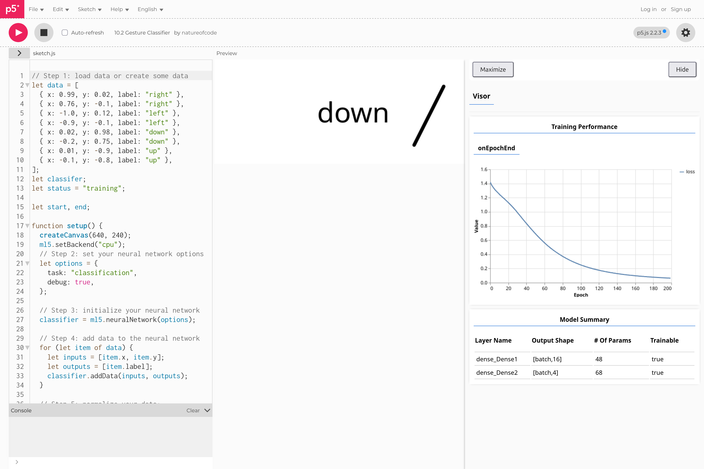
> 10.02 (gesture_classifier.py)
<!--
- so instead of the visor running upon sketch execute ... [NEXT SLIDE]
-->

---

<!--
_backgroundColor: black
_paginate: false
-->

> 10.02 (gesture_classifier.py)
<!--
- ... you see the training in the shell complete, then the sketch window launches
- (note: i added some of this hud stuff to a few sketches)
-->

---

## 2. Rethink Logic » Neuroevolution (NumPy Brain)
<highlight><em>brain_ne.py</em></highlight>

<smaller>

```python
# ml5.js-style neural network functionality implemented with bespoke class.

import numpy as np

class Brain:
    """Vectorized NumPy brain with GA helpers."""

    def __init__(self, inputs: int, outputs: int, hidden: int = 8) -> None:
        ...

    def forward(self, inputs: list[float]) -> list[float]:
        ...

    def classify_binary(self, inputs: list[float], threshold: float = 0.5) -> bool:
        ...

    def predict_continuous_01(self, inputs: list[float]) -> list[float]:
        ...
```

</smaller>

<!--
- ml5's neuroEvolution has no drop-in substitute -- wrote one (~50 lines)
- snippet lists classify and prediction methods
- but also has ga helpers (crossover, mutate) that operate directly on the weight arrays
- sometimes "rethinking" means realising the library was hiding very little
-->

---

# 3. Simplify Code
<!-- 
backgroundColor: darkolivegreen
color: var(--color-background)
-->

---

## 3. Simplify Code » Operator Overloading

```javascript
// p5.js -- verbose static/method calls
let force = p5.Vector.sub(attractor, mover);
force.normalize();
force.mult(strength);
mover.acceleration.add(force);
```

<hr style="color:rgba(255,255,255,0.3)" />

```python
# py5 -- reads more like the maths
force = (attractor - mover).norm * strength
mover.acceleration += force
```
<!--
- of course, you can chain the .normalize() and .mult() methods
-->

---

## 3. Simplify Code » Comprehensions

```javascript
// p5.js
let training = [];
for (let i = 0; i < 2000; i++) {
  training.push([random(-width/2, width/2), random(-height/2, height/2), 1]);
}
```

<hr style="color:rgba(255,255,255,0.3)" />

```python
# py5
training = [
  [random(-width / 2, width / 2), random(-height / 2, height / 2), 1]
  for _ in range(2000)
]
```
<!--
- of course, this is a pure python vs js thing (no py5 addition)
- also, the _ throwaway variable makes it immediately clear the index isn't used
- i used comprehensions pretty much wherever i could
-->

---

## 3. Simplify Code » Backward Filter

```javascript
// p5.js -- loop backward to splice safely
for (let i = particles.length - 1; i >= 0; i--) {
  particles[i].run();
  if (particles[i].isDead()) particles.splice(i, 1);
}
```

<hr style="color:rgba(255,255,255,0.3)" />

```python
# py5 -- same backward-loop technique works ...
for i in range(len(particles) - 1, -1, -1):
    particles[i].run()
    if particles[i].dead: del particles[i]
```

<br />
<i>If you're wondering about <code>.dead</code> ...</i>

<!--
- ... but i kept reverse loops, although there is arguably a more pythonic way
-->

---

## 3. Simplify Code » Properties over Methods

```javascript
// p5.js -- isDead() is a method call
if (particles[i].isDead()) particles.splice(i, 1);
...
isDead() {
  return (this.lifespan < 0.0);
}
```

<hr style="color:rgba(255,255,255,0.3)" />

```python
# py5 -- .dead is a @property (no parentheses)
if particles[i].dead: del particles[i]
...
@property
def dead(self) -> bool:
    return self.lifespan < 0.0
```
<!--
- isDead() becomes a .dead @property -- attribute access rather than a method call
- same pattern as py5's .mag and .heading on vectors
- (i didn't do this too extensively, as it felt like quite a deviation)
-->

---

## 3. Simplify Code » Slice Notation

```javascript
// p5.js
cells = new Array(floor(width / w)).fill(0);
let nextgen = cells.slice();

let [left, me, right] = cells.slice(i - 1, i + 2);
```

<hr style="color:rgba(255,255,255,0.3)" />

```python
# py5
cells = [0] * (width // w)
next_gen = cells[:]

left, me, right = cells[i - 1 : i + 2]
```
<!--
- note that i've further adapted/condensed the book's js here
- list building, slice copying, and slice unpacking shrink the wolfram cellular automata code
- integer division // avoids the js-style floor() call for grid math
- again, this is python vs js stuff (not py5)
-->

---

## 3. Simplify Code » Small Quality-of-Life Wins
<table style="width:100%;border:none;font-size:0.9em">
  <tr style="background-color:rgba(0,0,0,0.3)">
    <td style="border-color:rgba(0,0,0,0.3)">Python / py5</td>
    <td style="border-color:rgba(0,0,0,0.3)">Why</td>
  </tr>
  <tr style="background:none">
    <td style="border-color:rgba(0,0,0,0.3);background:transparent"><code>position += velocity</code></td>
    <td style="border-color:rgba(0,0,0,0.3);background:transparent">Augmented assignment on vectors</td>
  </tr>
  <tr style="background:none">
    <td style="border-color:rgba(0,0,0,0.3);background:transparent"><code>Particle(*self.origin)</code></td>
    <td style="border-color:rgba(0,0,0,0.3);background:transparent">Vectors unpack as iterables</td>
  </tr>
  <tr style="background:none">
    <td style="border-color:rgba(0,0,0,0.3);background:transparent"><code>10_000</code></td>
    <td style="border-color:rgba(0,0,0,0.3);background:transparent">Readable numeric literals</td>
  </tr>
  <tr style="background:none">
    <td style="border-color:rgba(0,0,0,0.3);background:transparent"><code>def step(self) -&gt; None:</code></td>
    <td style="border-color:rgba(0,0,0,0.3);background:transparent">Type hints document intent</td>
  </tr>
  <tr style="background:none">
    <td style="border-color:rgba(0,0,0,0.3);background:transparent">No <code>let</code> / <code>const</code> / <code>;</code> / <code>{}</code></td>
    <td style="border-color:rgba(0,0,0,0.3);background:transparent">Less syntactic noise</td>
  </tr>
  <tr style="background:none">
    <td style="border-color:rgba(0,0,0,0.3);background:transparent">Synchronous ML training</td>
    <td style="border-color:rgba(0,0,0,0.3);background:transparent">No callback pyramids</td>
  </tr>
</table>
<!--
- none of these are transformative alone; together the ports are consistently shorter
- type hints are optional but the py5 port uses them throughout
-->

---

# Materials
<!-- 
backgroundColor: saddlebrown
color: var(--color-background)
-->

---

<!--
_backgroundColor: #EEE
_paginate: false
-->
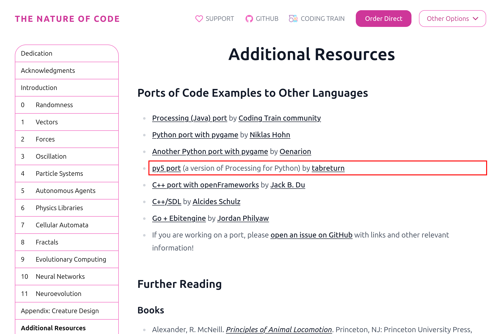
> https://natureofcode.com
<!--
- the book is free to read online; the additional resources page lists ports to other languages
- the py5 port lives alongside pygame, openframeworks, and go ports
- clicking link goes to ... [NEXT SLIDE]
-->

---

<!--
_backgroundColor: #EEE
_paginate: false
-->

> https://github.com/tabreturn/py5-nature-of-code
<!--
- scroll ... [NEXT SLIDE]
-->

---

<!--
_backgroundColor: #EEE
_paginate: false
-->
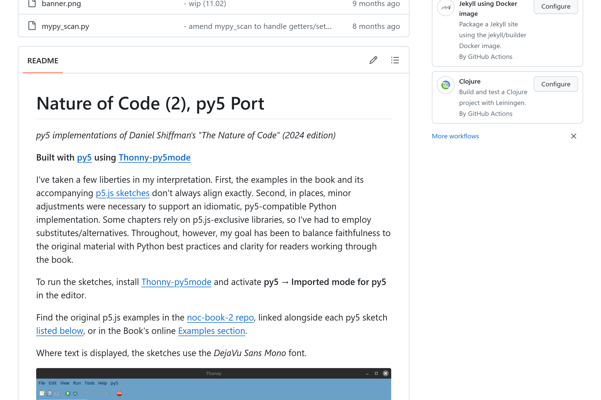
> https://github.com/tabreturn/py5-nature-of-code
<!--
- scroll ... [NEXT SLIDE]
-->

---

<!--
_backgroundColor: #EEE
_paginate: false
-->
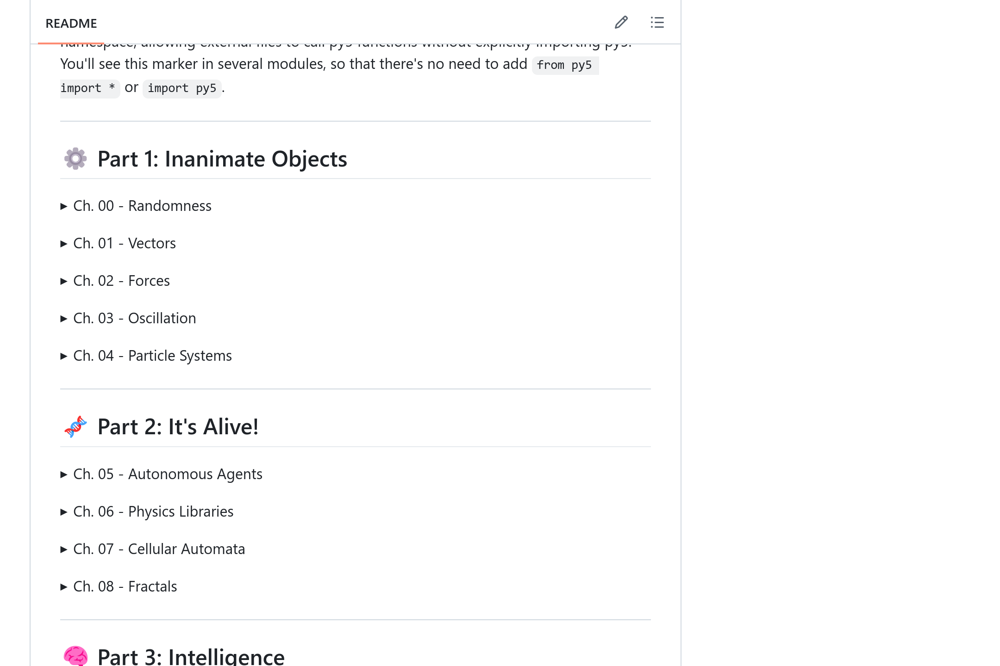
> https://github.com/tabreturn/py5-nature-of-code
<!--
- the readme links every py5 sketch to its original p5.js editor sketch
-->

---

## Materials » Jupyter py5 Port
by @hollygrimm

<https://github.com/hollygrimm/py5-noc-book-2>

<hr style="color:rgba(255,255,255,0.3)" />

*Jupyter notebooks (`.ipynb`) · Module mode (`import py5`) · Pymunk for all of ch06; no Toxiclibs · similar scikit-learn + hand-rolled NumPy approach.*

---

<!--
_backgroundColor: #EEE
_paginate: false
-->

> https://github.com/hollygrimm/py5-noc-book-2
<!--
- if notebooks are your style: all 12 chapters as runnable jupyter notebooks ... [NEXT SLIDE]
-->

---

<!--
_backgroundColor: #EEE
_paginate: false
-->

> https://github.com/hollygrimm/py5-noc-book-2
<!--
- book prose, figures, and editable py5 cells interleaved per chapter
-->

---

## *End*
<!-- 
paginate: false 
backgroundColor: black
color: var(--color-background)
-->

